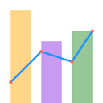

  

# plotviz

**plotviz** is a desktop chart editor for scientists, engineers, and analysts. Load tabular data, build publication-quality charts through a point-and-click interface, and export to PNG, SVG, PDF, JPEG, TIFF or EPS — no code required.

---

## Features

- **26 chart types** — line, scatter, bar, area, histogram, box, violin, heatmap, waterfall, bubble, and more, with per-series mixing in multi-panel layouts
- **Seaborn Explorer** — dedicated dialog for statistical charts (KDE, regression, pairplot, joint, catplot, and more), fully isolated from the main canvas
- **Python Code Runner** — write and run arbitrary matplotlib/seaborn code in a built-in editor with a live preview pane
- **Digitize Image** — read the values of a chart that is only a picture: calibrate the axes (straight, rotated or tilted pictures), click on the curves or let plotviz follow their colour, and add them as columns
- **Python Export Bundle** — export any chart as a self-contained `.pvizx` ZIP with a standalone `plot.py` script and data CSVs; no plotviz dependency required to re-run
- **Subplots & mosaic layouts** — multi-panel figures with shared axes and custom grid arrangements
- **Data tools** — generate series from expressions, summaries and correlations, and 36 Transform operations (smoothing, resampling, calculus, peaks, FFT) with a live preview
- **Curve fitting** — linear, polynomial, exponential, Gaussian, sinusoid, custom expressions and LOWESS, with confidence and prediction bands and a comparison by AIC
- **Annotations** — text, arrows, images, legends, and subplot titles
- **Color schemes and palettes** — 13 built-in schemes and 11 palettes, plus your own
- **Undo and redo** — up to 50 steps
- **Reload and recover** — read again the data files that changed on disk, and restore an unsaved chart after a crash
- **Cross-platform** — macOS 11+, Windows 10+, and Linux (X11/Wayland)

---

## Quick start

**Download the latest release** (no Python required):
[macOS DMG / Windows ZIP → GitHub Releases](https://github.com/pcachim/plotviz/releases/latest)

See [Getting Started](docs/getting-started.md) for full installation and interface details.

---

## Documentation

Full documentation is available at **https://pcachim.github.io/plotviz/**

| Document | Contents |
|----------|----------|
| [Getting Started](docs/getting-started.md) | Installation, first chart, interface overview |
| [Worked Examples](docs/examples.md) | Three walks from the data to the chart |
| [Datasets and Import](docs/datasets.md) | Loading files, import options, date columns |
| [Generate](docs/generate.md) | Function generators and the manual data table |
| [Statistics](docs/statistics.md) | Summary table and correlation matrix |
| [Transform](docs/transform.md) | Smoothing, resampling, calculus, signal analysis |
| [Layout & Style](docs/layout-style.md) | Figure size, margins, title |
| [Subplots](docs/subplots.md) | Multi-panel layouts, mosaic, shared axes |
| [Color Schemes](docs/color-schemes.md) | Coordinated colour presets |
| [Color Palettes](docs/palettes.md) | Built-in palettes, custom palettes |
| [Plot](docs/plot.md) | The series table and plot modes |
| [Chart Types](docs/chart-types.md) | All 26 chart types and their options |
| [Curves and Fitting](docs/curves.md) | Per-curve style, markers, curve fitting |
| [Axes](docs/axes.md) | Labels, limits, scales, ticks, formatters |
| [Canvas & Grid](docs/canvas-grid.md) | Plot area, borders, grid |
| [Legend and Notes](docs/legend-notes.md) | Legends, text, arrows, images |
| [Seaborn Explorer](docs/seaborn-explorer.md) | Statistical charts via seaborn |
| [Python Code Runner](docs/code-runner.md) | Built-in Python editor with live preview |
| [Digitize Image](docs/digitize.md) | Read values off a picture of a chart |
| [Export Image](docs/export.md) | Formats, resolution, clipboard, one file per subplot |
| [Python Export Bundle](docs/python-export.md) | Export charts as standalone Python projects |
| [File Formats](docs/file-formats.md) | .pviz, .pvizt, .pvizc, .pvizp, .pvizx |
| [Licenses](docs/licenses.md) | The licence of plotviz and of what it contains |
| [Troubleshooting](docs/troubleshooting.md) | The messages of the app and what to do |
| [Glossary](docs/glossary.md) | The terms used in the app |
| [Menus](docs/menus.md) | Every menu item, the samples, the preferences |
| [Keyboard Shortcuts](docs/shortcuts.md) | All keyboard shortcuts |
| [Building & Packaging](BUILDING.md) | macOS .app and Windows .exe (for developers) |

---

## Requirements

- Python 3.10 or later
- macOS 11+, Windows 10+, or Linux (X11/Wayland)

Dependencies are installed automatically via pip:

| Package | Version | Purpose |
|---------|---------|---------|
| PyQt6 | ≥ 6.5 | UI framework |
| matplotlib | ≥ 3.7 | Chart rendering |
| seaborn | ≥ 0.13 | Statistical charts |
| numpy | ≥ 1.24 | Numerical arrays |
| pandas | ≥ 2.0 | Data loading |
| scipy | ≥ 1.10 | Curve fitting and statistics |
| statsmodels | ≥ 0.14 | Regression and LOWESS |
| openpyxl | ≥ 3.1 | Excel file support |
| platformdirs | ≥ 3.0 | Settings directory |

---

## License

plotviz is released under the GPL-3.0-or-later — see [LICENSE.md](LICENSE.md); the source of each release is at the address in [SOURCE.md](SOURCE.md).

It contains open-source packages under their own licences (BSD, MIT, Apache, and, for the Qt libraries, the LGPL v3). They are listed, with the text of each licence, in [THIRD-PARTY-NOTICES.md](THIRD-PARTY-NOTICES.md) and explained in the [Licenses](docs/licenses.md) page of the documentation.

---

## Version

The latest release is on the [Releases page](https://github.com/pcachim/plotviz/releases/latest).
