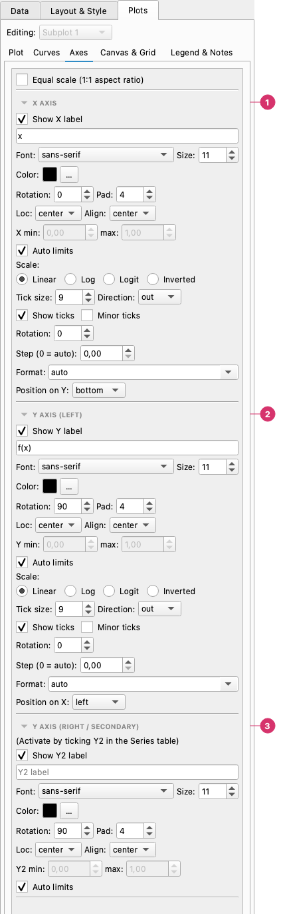
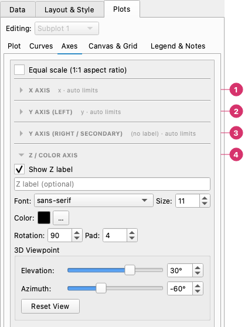

# Axes

The **Axes** tab controls per-subplot axis configuration: the subplot title, axis labels, limits, scale, ticks, and the secondary Y axis. When the chart has more than one subplot, a **Subplot** selector at the top lets you switch between panels. Changing the selector in the Axes tab automatically syncs with the selectors in the other Plots pages.

## The Axes page

From top to bottom (**Equal scale** is at the very top):

1. **X axis** — Label (text, font, size, colour, rotation, position), limits or **auto limits**, the **scale** (linear, log, logit, inverted), tick size, direction, minor ticks, step, format, and where the axis sits.
2. **Y axis (left)** — The same settings for the left y axis.
3. **Y axis (right / secondary)** — The same for the secondary axis, active when a series has **Y2** ticked.

---

## Subplot title

The **Subplot Title** section is at the top of the tab and only appears when the chart has more than one panel. For a single-panel chart, the chart title is set in the **Layout & Style** tab.

| Control | Description |
|---------|-------------|
| **Show title** | Checkbox: toggle title visibility |
| **Text field** | Title text for this subplot |
| **Font / Size / Color** | Typography |
| **Pad** | Distance between the title and the top of the axes (points) |
| **Rot** | Rotation in degrees |
| **Align** | center, left or right |

---

## Axis labels

Each axis (X, Y, Y2) has three controls:

| Control | Description |
|---------|-------------|
| **Show label** | Checkbox — hide the label without clearing the text |
| **Text field** | The label text (placeholder shows the column name when empty) |
| **Font / Size / Color** | Typography for the label |

When the text is empty the axis is titled with the names of the data series; fitted curves are left out of that default, so adding several fits does not lengthen the title (type a label if you want the fits named).

X and Y label fonts and colors are global — they apply to all subplots. Per-subplot overrides are not available for axis labels.

### Math in labels

Titles, axis labels, legend entries and annotation text accept matplotlib's math text: put the formula between dollar signs.

| Type this | You get |
|-----------|---------|
| `time $t$ (s)` | time *t* (s) |
| `$\sigma$ (MPa)` | σ (MPa) |
| `Decay: $y = A\,e^{-t/\tau}$` | Decay: *y* = *A* e−*t*/τ |
| `$\sin(\omega t)$` | sin(ω*t*) |

It is drawn by matplotlib itself, so nothing has to be installed. Full LaTeX typesetting is not used: commands such as `\begin{align}` do not work.

---

## Axis limits

| Control | Description |
|---------|-------------|
| **Auto** | Checkbox — let matplotlib choose limits automatically (default on) |
| **Min / Max** | Manual limit values, active only when Auto is off |

Uncheck **Auto** and set Min/Max to zoom into a specific data range without changing the data itself.

---

## Axis scale

Four radio buttons set the scale for each axis:

| Scale | Description |
|-------|-------------|
| **Linear** | Uniform spacing (default) |
| **Log** | Logarithmic spacing — requires all data > 0 |
| **Logit** | Logit scale for probabilities (0–1) |
| **Inverted** | Linear scale with the axis reversed (high values at the left/bottom) |

---

## Tick marks

| Control | Description |
|---------|-------------|
| **Show ticks** | Checkbox — hide tick marks and labels entirely |
| **Tick size** | Font size for tick labels (pt) |
| **Tick direction** | `out` (default), `in`, or `inout` |
| **Minor ticks** | Checkbox — show minor tick marks between major ticks |
| **Rotation** | Angle of tick labels in degrees (useful for long X labels) |
| **Step** | Force a fixed interval between major ticks (0 = automatic) |

---

## Tick formatters

The **Formatter** dropdown on each axis controls how tick values are displayed:

| Formatter | Example output |
|-----------|---------------|
| auto | matplotlib default |
| plain | `1234567` (no scientific notation) |
| sci | `1.23 × 10⁶` |
| percent | `12.3%` |
| `{x:.2f}`, `{x:.0f}`, … | any Python format string with `{x}`: `3.14`, `3` |
| `%Y-%m-%d`, `%d/%m/%Y`, `%b %Y`, `%H:%M`, … | a [date format](https://docs.python.org/3/library/datetime.html#strftime-and-strptime-format-codes), for an axis that shows dates |

The dropdown is editable, so you can type any format. Date formats only make sense on an axis that shows a date column; see [Date and time columns](datasets.md#date-and-time-columns). With **auto**, a date axis picks sensible ticks and labels by itself (years, months, days or hours, depending on the range).

---

## Secondary Y axis (Y2)

Enable the secondary Y axis by ticking the **Y2** checkbox on one or more series rows in **Plots → Plot**. The Y2 axis appears on the right side of the plot.

In the Axes tab, the Y2 section provides the same controls as the primary Y axis: label text/font/size/color, limits (auto or manual).

---

## Z / color axis and 3D viewpoint

The **Z / Color Axis** section appears when the subplot is a **3D Surface**, **Heatmap**, **Contour** or **Tricontour** chart. For a 3D surface it labels the vertical axis; for the other three it labels the colour bar. The other axes are folded in this picture:

1. **X axis** — folded here; see above.
2. **Y axis (left)** — folded here; see above.
3. **Y axis (right / secondary)** — folded here; see above.
4. **Z / color axis** — **Show Z label**, the label text and its font, size, colour, rotation and distance (**Pad**). For a 3D surface the **3D Viewpoint** box below sets the **Elevation** (−90° to 90°) and the **Azimuth** (−180° to 180°) with a slider or a number; **Reset View** returns to 30° and −60°. In the preview you can also rotate the chart by dragging it.

---

## Subplot spacing

When the chart has more than one subplot, two sliders in the Axes tab control the spacing between panels:

| Control | Description |
|---------|-------------|
| **H space** | Vertical gap between rows of subplots (height fraction) |
| **W space** | Horizontal gap between columns of subplots (width fraction) |
