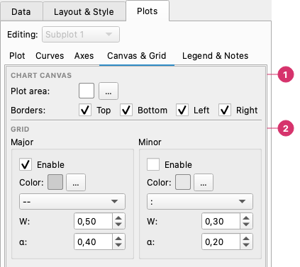

# Canvas & Grid

The **Plots → Canvas & Grid** page sets the look of the plot area of one subplot: its colour, which borders are drawn, and the grid. With several subplots, the **Editing** selector at the top of the Plots tab chooses which one. The figure background and the colours of text and axes belong to the whole figure and are in [Color Schemes](color-schemes.md).

From top to bottom:

1. **Chart canvas** — The colour of the plot area and which **borders** (top, bottom, left, right) are drawn.
2. **Grid** — The **major** and **minor** grid: switch each on, and set colour, line style, width and opacity (α).

---

## Plot area and borders

### Plot area

The colour of the plot area, the inner background inside the axes. With several subplots each one has its own: changing it here is a local adjustment of this subplot and does not change the colour scheme.

### Borders (spines)

Four checkboxes — **Top, Bottom, Left, Right** — show or hide the four axis border lines (spines). Hiding the top and right spines is a common convention for scientific plots.

---

## Grid

| Control | Description |
|---------|-------------|
| **Show grid** | Toggle the major grid on/off |
| **Grid color** | Color of major grid lines |
| **Line style** | Solid, dashed, dotted, or dash-dot |
| **Line width** | Stroke thickness (0.1–5.0) |
| **Alpha** | Grid line opacity (0.0–1.0) |
| **Show minor grid** | Toggle the minor grid (sub-divisions between major ticks) |

Minor grid controls (color, style, width, alpha) mirror the major grid controls.
