# Chart Types

plotviz supports 26 chart types. Types marked **per-series** can be mixed freely in the same subplot. Types marked **whole-chart** take over the entire panel and cannot be combined with other types.

---

## Per-series types

These types are assigned per row in the series table. Multiple series with different types can share the same subplot axes.

### Line

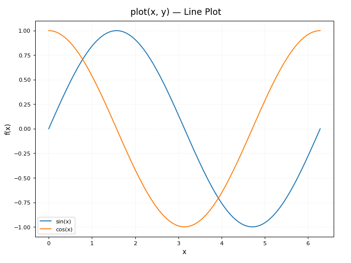

A classic line chart connecting data points in X order. Default options:

- **Line style** — solid, dashed, dotted, dash-dot, or none.
- **Line width** — stroke thickness in points.
- **Marker** — point shape (circle, square, triangle, cross, diamond, etc.) or none.
- **Marker size** — size of each point marker.
- **Color** — line and marker fill color.

Configured in the **Series** tab.

### Scatter

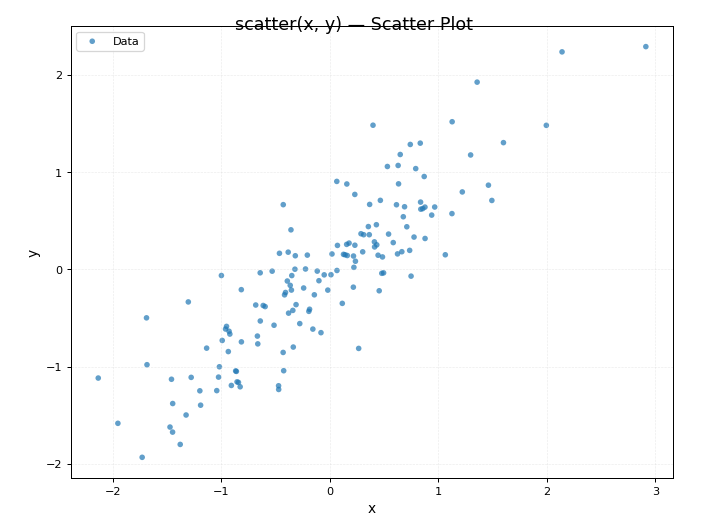

Plots each (X, Y) pair as an independent point with no connecting line. Options: point size, alpha (opacity), color.

### Bar

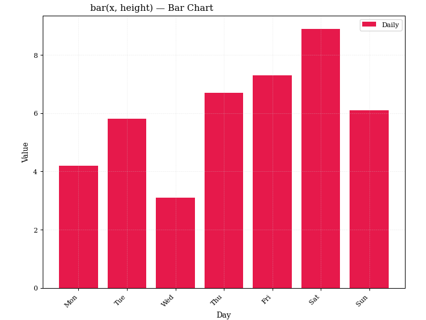

Vertical grouped bars. One bar per data point, one group per X value. Options:

- **Width** — bar width as a fraction of available space (0.05–1.0, default 0.8).
- **Stacked** — accumulates bars vertically instead of grouping side by side.
- **Horizontal** — rotates the chart 90° (bars grow left/right).

### Errorbar

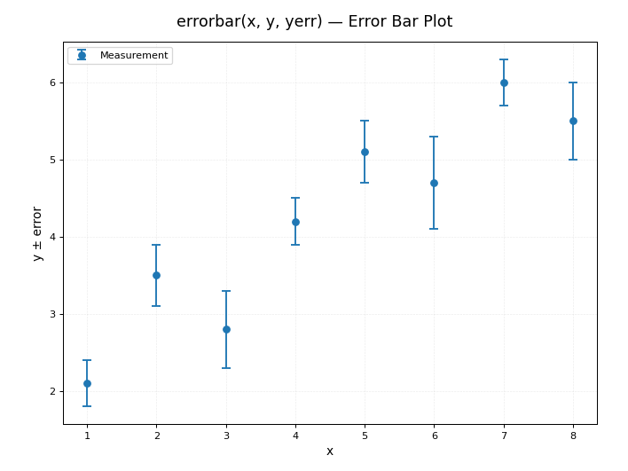

Line chart with error bars drawn at each point. Requires a column assigned to the **Error** dropdown below the series table. Options: **Cap size** (length of the horizontal cap lines).

### Area

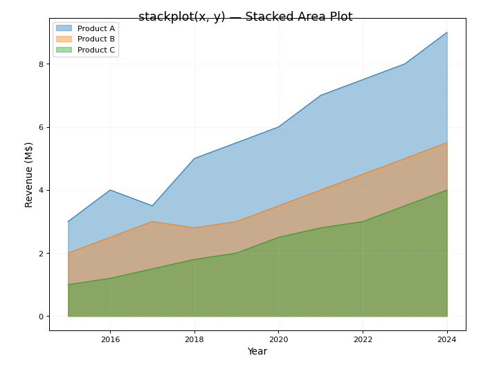

Filled region between the line and the X axis (or between two lines if stacked). Options:

- **Fill alpha** — transparency of the filled region (0.05–1.0, default 0.4).
- **Stacked** — accumulates areas vertically.

### Fill Between

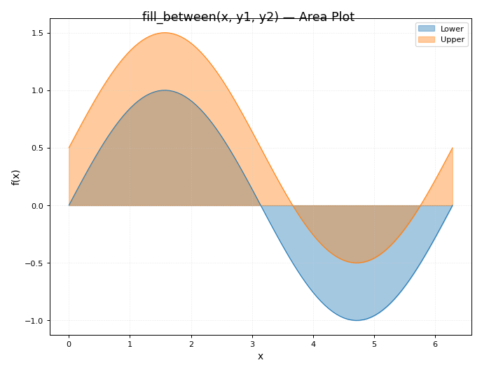

The area between a series and a second series (the **Fill Between Y2** dropdown), or between the series and the X axis when none is chosen. Options:

- **Alpha** — transparency of the filled region.
- **Line width** and **Show line** — the outlines of the two curves.

### Step

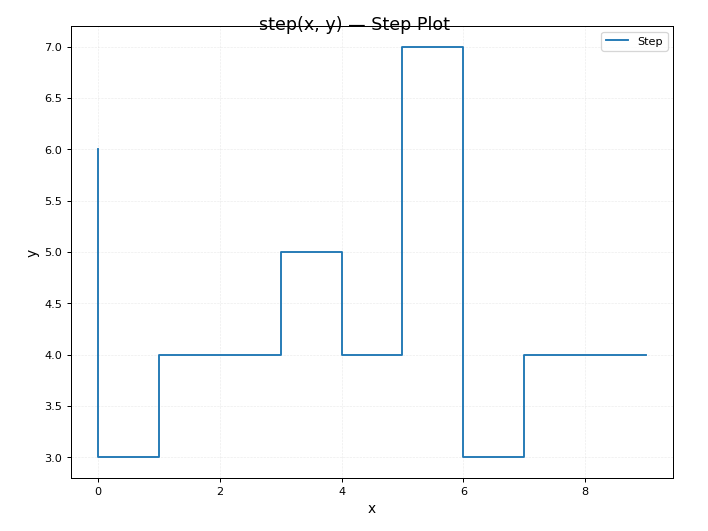

Like Line but uses a staircase interpolation between points instead of straight lines. Useful for discrete or sampled data, histograms drawn as steps.

### Stem

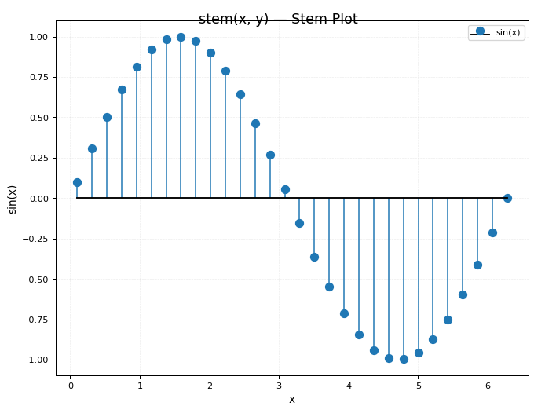

Draws vertical lines (stems) from the X axis to each data point, with a marker at the tip. Good for sparse discrete signals.

### Bubble

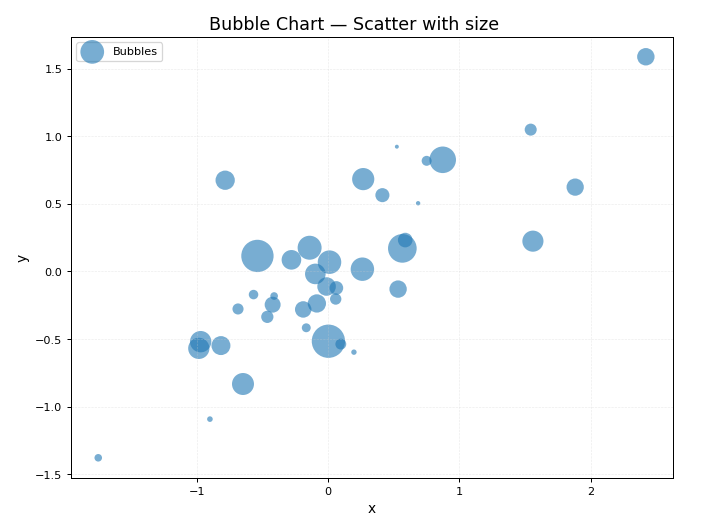

Scatter chart where the size of each point is controlled by a third column assigned to the **Z** dropdown. Options:

- **Size col** — which column drives the bubble radius (or "(uniform)" for equal sizes).
- **Scale** — multiplier applied to Z values to compute pixel radius.
- **Alpha** — fill opacity.
- **Marker** — point shape.
- **Edge color** — outline color around each bubble.

### Waterfall

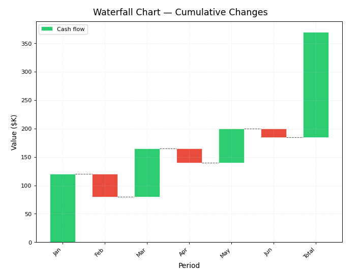

Cumulative bar chart where each bar starts where the previous one ended. Positive increments grow upward (green by default), negative increments fall (red). Options:

- **Show connectors** — horizontal lines linking the top/bottom of adjacent bars.
- **Bar width** — width as a fraction of cell.
- **Pos color / Neg color** — colors for positive and negative bars.
- **Alpha** — fill opacity.

---

## Whole-chart types

These types use all series columns together and cannot be mixed with other types in the same subplot.

### Histogram

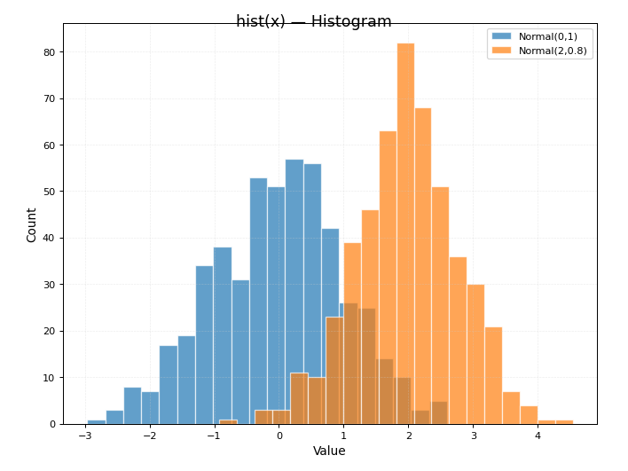

Distribution of a single Y column. Options:

- **Bins** — number of histogram bins (2–500, default 20).
- **Density** — normalize the Y axis to show probability density instead of counts.

### Hist2D

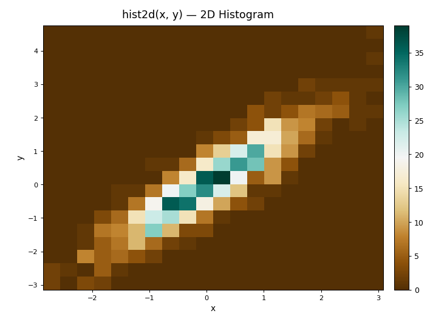

2D histogram (heatmap of point density) using X and Y columns together. Options: **Colormap**, **Bins**.

### Hexbin

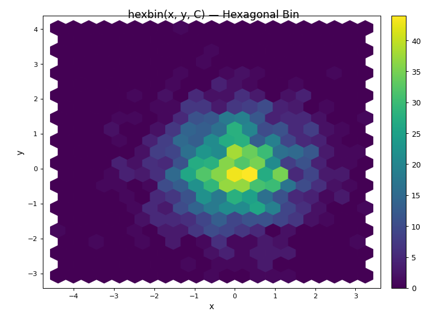

Like Hist2D but aggregates points into hexagonal cells. Options: **Colormap**, **Bins**.

### Boxplot

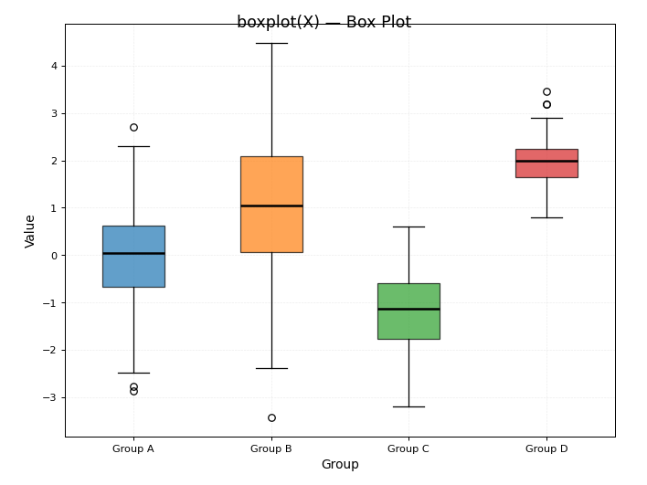

Box-and-whisker plots showing median, quartiles and outliers for one or more Y columns. Multiple series produce side-by-side boxes.

### Violin

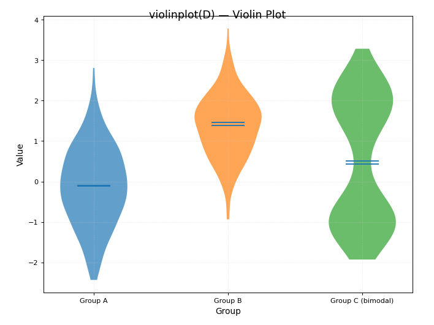

Kernel-density estimate of the distribution, mirrored to form a violin shape. Options:

- **Show means** — horizontal line at the mean.
- **Show medians** — horizontal line at the median.
- **Show extrema** — lines at the minimum and maximum.
- **Points** — number of points in the KDE (100/200/500/1000).
- **bw_method** — bandwidth selection for the KDE (scott or silverman).
- **Vertical** — draw violins vertically (default) or horizontally.

### Pie

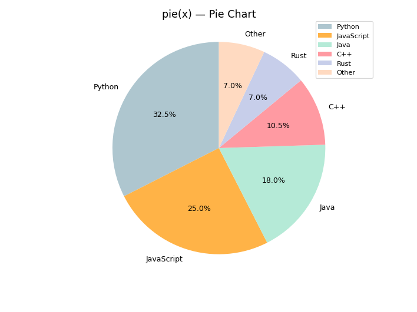

Circular sector chart. Each Y value becomes a slice whose angle is proportional to its share of the total. Options:

- **Show %** — print the percentage inside each slice.
- **Shadow** — drop shadow under the pie.

### Polar

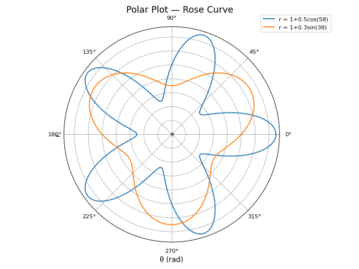

Line or scatter chart in polar coordinates. X is the angle (radians), Y is the radius. Options:

- **Line style**, **Line width**, **Marker** — visual style.
- **Fill** — fill the area under the polar line.

### Radar

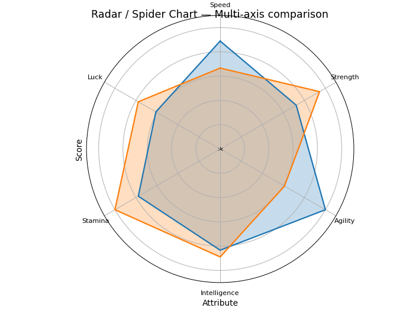

Spider/radar chart. Each column in the Y data becomes one axis radiating from the center. Multiple series are overlaid. Useful for comparing multivariate profiles.

### Heatmap

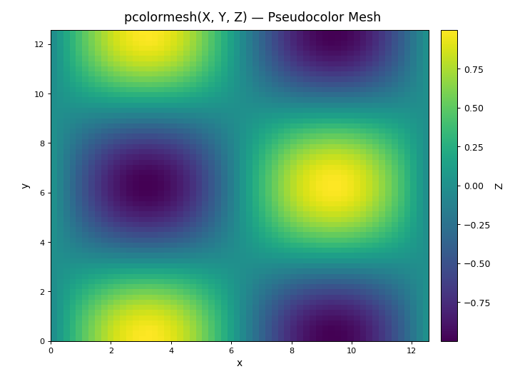

2D color grid. Requires a Z column. Plots X values along one axis, Y values along the other, and colors cells by Z. Options:

- **Colormap** — matplotlib colormap (viridis, plasma, coolwarm, etc.).
- **Show colorbar** — display the color scale legend.

### Contour

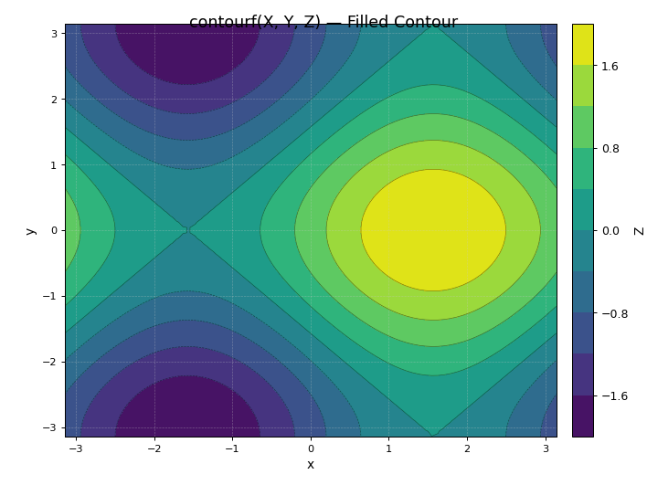

Contour or filled contour plot of a 2D scalar field. Requires X, Y and Z columns on a regular or irregular grid. Options:

- **Colormap** — color mapping for the contour levels.
- **Contour levels** — number of isolines (3–100, default 10).

### Tricontour

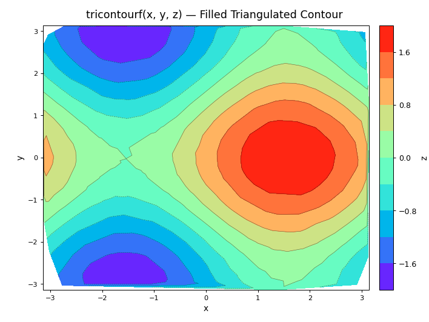

Contour plot of a scalar field known at scattered points (no regular grid needed): the points are triangulated. Requires X, Y and Z columns. Options:

- **Fill** — *Filled contour*, *Face colours* (one colour per triangle) or *None*.
- **Levels**, **Alpha** and **Colormap**.
- **Lines** — contour lines over the fill; **Triangulation** shows the triangles.
- **Colorbar** and its size.

### 3D Surface

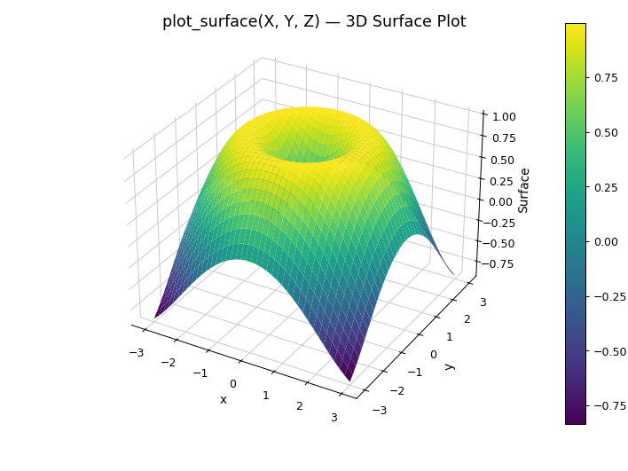

Three-dimensional surface plot. Requires X, Y and Z columns. The canvas renders in 3D; rotate the view by clicking and dragging.

### ECDF

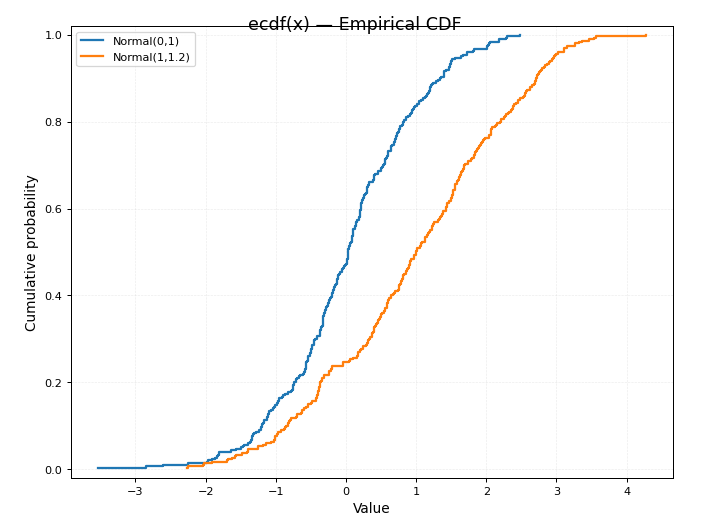

Empirical Cumulative Distribution Function. Plots the fraction of data points ≤ each X value. Useful for comparing distributions without binning.

### Quiver

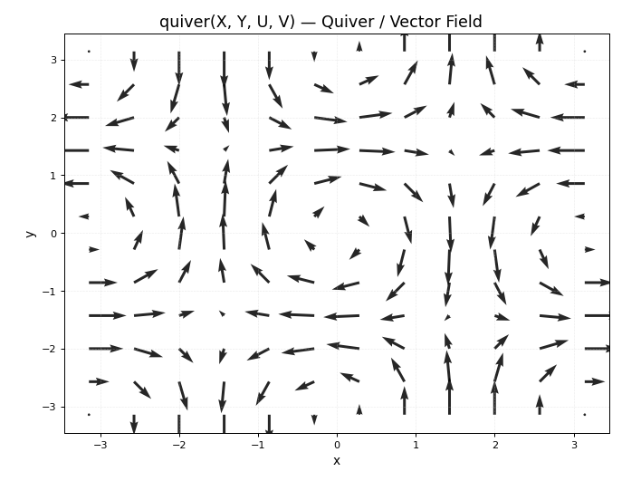

Vector field plot: an arrow at each (X, Y) point. The direction and length of the arrow come from two columns chosen in the **U** (horizontal component) and **V** (vertical component) dropdowns. Options:

- **Scale** — arrow length scale (1.0 = automatic).
- **Width** — shaft width.
- **Color by magnitude** — colour each arrow by its length, with a **Colormap**.

### Barbs

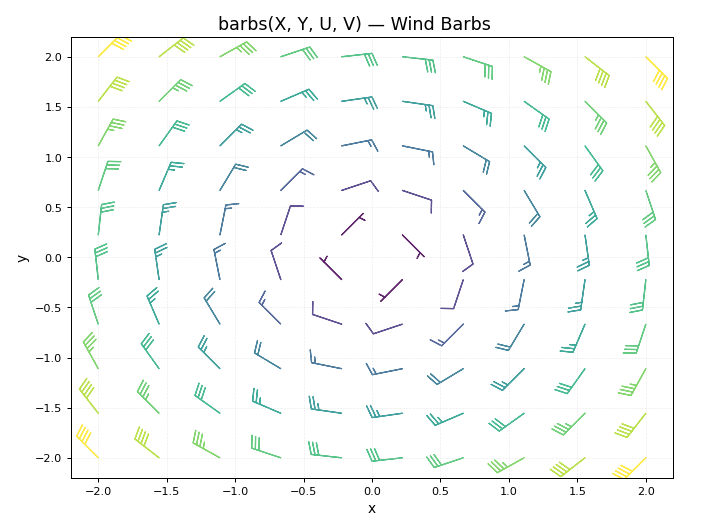

Meteorological wind barbs: at each (X, Y) point a staff with flags and feathers whose number tells the wind speed, pointing along the **U** and **V** components. Options:

- **Length** — length of the staff in points.
- **Pivot** — which end of the staff sits on the point (tip or middle).
- **Alpha** — opacity.
- **Color by magnitude** — colour by speed, with a **Colormap**.

### Streamplot

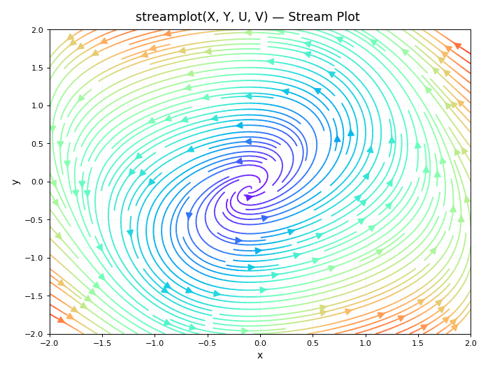

Streamlines of a vector field. X and Y must be the points of a regular grid (every x with every y, for example from **Generate → (u,v)=f(x,y)** with *Meshgrid*), with the field components in the **U** and **V** dropdowns. Options:

- **Density** — how closely the lines are packed.
- **Arrow size** and **Line width**.
- **Color by magnitude** — colour by speed, with a **Colormap**.

---

## Chart-type options panel

When a whole-chart type is active, a corresponding options panel appears in the **Data** tab below the series table. Per-series options (line style, marker, color) are set in the **Series** tab regardless of chart type.
