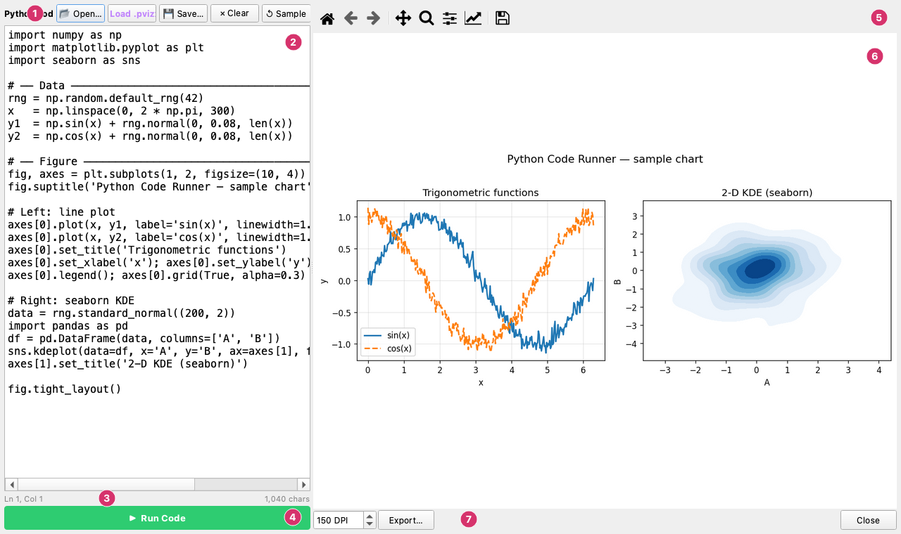
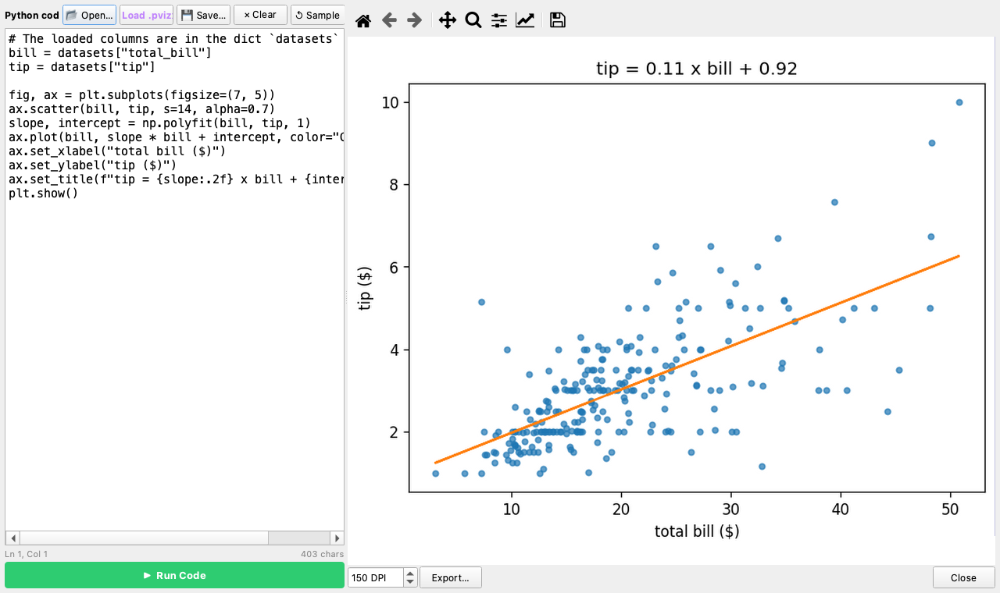
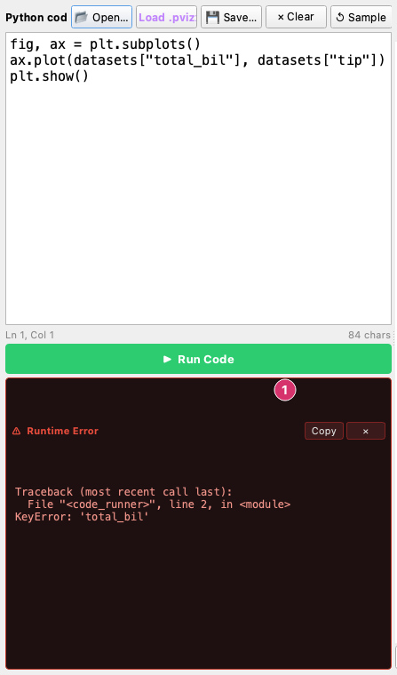

# Python Code Runner

The **Python Code Runner** is a built-in code editor that lets you write arbitrary Python code — using matplotlib, seaborn, numpy, pandas, or any installed library — and render the resulting chart in a live preview pane, all without leaving plotviz.

Open it from the menu bar: **Tools → Python Code Runner…**

---

## Interface



The window:

1. **Editor toolbar** — **Open…** a `.py` file, **Load .pvizx…** a Python bundle, **Save…**, **Clear** and **Sample**.
2. **Editor** — The code, with syntax highlighting.
3. **Status line** — The line and column of the cursor, and the number of characters.
4. **Run Code** — Runs the code (`Ctrl + Enter`).
5. **Canvas toolbar** — The matplotlib tools for the preview.
6. **Preview** — The figure that the code made.
7. **Export bar** — The **DPI**, **Export…** and **Close**.

The window is split into two panels:

| Panel | Contents |
|-------|----------|
| **Left — editor** | Syntax-highlighted Python editor with toolbar, status bar, run button, and error panel |
| **Right — preview** | Live matplotlib canvas with navigation toolbar and export controls |

---

## Editor toolbar

| Button | Action |
|--------|--------|
| **📂 Open…** | Load code from a `.py` file |
| **📦 Load .pvizx…** | Load and immediately run a Python Export bundle (`.pvizx`) |
| **💾 Save…** | Save the current editor contents to a `.py` file |
| **✕ Clear** | Clear the editor |
| **↺ Sample** | Restore the built-in sample chart code |

---

## Writing code

The editor supports full Python syntax with highlighting for keywords, strings, comments, numbers, and function names.

### Available shortcuts

| Shortcut | Action |
|----------|--------|
| `Ctrl + Enter` (or `Cmd + Enter` on macOS) | Run the code |
| `Tab` | Indent the selected block |
| `Shift + Tab` | Dedent the selected block |

### Namespace

When your code runs, the following names are available without any import:

| Name | Type | Contents |
|------|------|----------|
| `np` / `numpy` | module | NumPy |
| `plt` / `matplotlib` | module | Matplotlib and `pyplot` |
| `mpl` | module | `matplotlib` root module |
| `pd` / `pandas` | module | Pandas (if installed) |
| `sns` / `seaborn` | module | Seaborn (if installed) |
| `scipy` | module | SciPy (if installed) |
| `datasets` | dict | All columns currently loaded in plotviz — keys are column names, values are NumPy arrays |

You can import any other installed package normally inside your code.

### Using plotviz datasets

If you have data loaded in the plotviz **Data** tab, you can reference those columns directly:

```python
import numpy as np
import matplotlib.pyplot as plt

x = datasets['time']       # NumPy array
y = datasets['pressure']

fig, ax = plt.subplots()
ax.plot(x, y, linewidth=1.8)
ax.set_xlabel('Time (s)')
ax.set_ylabel('Pressure (Pa)')
plt.tight_layout()
```

With the `tips` sample dataset loaded, a scatter plot with a fitted line:



### Figure requirements

Your code must create at least one matplotlib figure (`plt.figure()`, `plt.subplots()`, or a seaborn figure-level function). If it runs without producing a figure, a message is shown in the preview canvas.

If your code creates multiple figures, the **last** one is displayed in the preview.

---

## Running code

Click **▶ Run Code** or press `Ctrl + Enter`. The canvas updates immediately.

All matplotlib figures from a previous run are closed before each new run, so stale figures never accumulate.

---

## Error panel

If your code raises an exception, an error panel appears below the editor with the traceback of your code (only your own lines). The canvas shows a brief error notice on the right.



1. **Runtime Error** — the exception and the line of your code that raised it; here a column name with a typo, `total_bil`.

The panel has two buttons:

| Button | Action |
|--------|--------|
| **Copy** | Copy the full traceback to the clipboard |
| **✕** | Dismiss the error panel |

Fix the code and run again — the error panel hides automatically at the start of each successful run.

---

## Loading a .pvizx bundle

A `.pvizx` file is a Python Export bundle generated by **File → Export Python Bundle (.pvizx)…**. It contains a standalone `plot.py` script and the chart's data as CSV files.

Click **📦 Load .pvizx…** to open a bundle. plotviz extracts the archive, loads `plot.py` into the editor, and runs it automatically. You can then inspect, edit, or extend the generated code.

---

## Exporting

After running, you can save the rendered chart using the **Export…** button in the bottom-right corner.

| Control | Description |
|---------|-------------|
| **DPI spinner** | Export resolution (72–600 DPI, default 150) |
| **Export…** | Save as PNG, SVG, PDF, or JPEG |

---

## Persistence

The Code Runner window hides rather than closes when you press **Escape** or the close button — your code is preserved for the session. Re-opening it from the menu restores the editor exactly as you left it.
