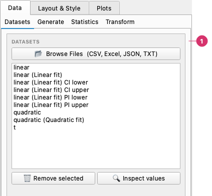

# Datasets and Import

The **Data → Datasets** page loads your files and lists every column the chart can use.

## Loading files

The **Datasets** page of the Data tab:

1. **Datasets** — **Browse Files** opens the import dialog. The list below shows every column loaded, from files and also those created by Generate, Transform and curve fits; select one or more to act on them. **Remove selected** deletes the selected columns, **Inspect values** shows a summary and lets you edit them.

Open the **Data** tab and click **Browse Files** to load one or more data files. Supported formats:

| Format | Extensions | Notes |
|--------|-----------|-------|
| CSV | `.csv` | Separator, decimal mark and encoding selectable |
| Excel | `.xlsx`, `.xls` | Choose the sheet in the import dialog |
| JSON | `.json` | Array of objects or column-oriented dict |
| Plain text | `.txt` | Whitespace-separated columns |

Each file opens an import dialog with a preview of the first 100 rows. You can pick the columns to import and rename them. Numeric columns become float arrays, date columns become dates (below), and other text columns are treated as categorical. Column names are taken from the first row.

### Import options

| Option | Applies to | Purpose |
|--------|-----------|---------|
| Sheet | Excel | Which sheet to read |
| Separator | CSV, TXT | Auto-detect, comma, semicolon, tab, whitespace, pipe or a custom character |
| Decimal | CSV, TXT | `Point (1.5)` or `Comma (1,5)`. Use the comma for files from European locales, otherwise numbers such as `1,5` are read as text |
| Encoding | CSV, TXT | `utf-8-sig` (the default) reads plain UTF-8 and the marker Excel adds at the start of the file; try `latin-1` or `cp1252` if accented characters look wrong |
| Orientation | JSON | Layout of the JSON data |
| Header row, Skip rows | All | Where the column names are, and how many lines to ignore before them |

You can load multiple files in one session — each file's columns are pooled into the shared column list and available in all series rows.

### Date and time columns

Columns that hold dates or times are recognised when you import them and marked with 📅 in the column list. They can be used as the X (or Y) of any series, and the axis then shows dates, with ticks that adapt to the range: years, months, days, hours…

Recognised formats include `2024-03-01`, `2024-03-01 12:30`, `2024-03-01T12:30:00`, `1 Mar 2024`, `March 5, 2024` and `03/04/2024`, and Excel date cells. A text column is only taken as dates when **every** value looks like a date, so names such as `May` or numbers such as `1,5` stay as they were. Two import options control this:

| Option | Purpose |
|--------|---------|
| **Dates: auto-detect / off** | Turn the detection off to keep date-like columns as plain text |
| **Day first** | Read `03/04/2024` as 3 April instead of March 4 |

Things to know:

- A date column is kept as the number of days since 1970-01-01 (fractions are the time of day), so everything that works on numbers keeps working: transforms, fits, statistics. Time zones are converted to UTC and dropped.
- The tick labels follow the range automatically. To choose them, type a date format such as `%d/%m/%Y` in the axis **Format** box ([Axes](axes.md#tick-formatters)).
- Limits and the tick step typed in the Axes tab are in **days** (for example a step of 7 puts a tick every week).
- Log scales are ignored on a date axis.
- Saved charts keep dates as dates, and so does the [Python export](python-export.md).
- The Seaborn Explorer and the Code Runner see date columns as numbers (days since 1970-01-01). In the Code Runner use `pd.to_datetime(x, unit='D')` to get datetimes back.

### Removing datasets

Select one or more entries in the **Datasets** list and click **Remove selected**. Any series that reference removed columns will show empty dropdowns but are not deleted from the table.

### Inspecting columns

Select a column (or multiple columns) in the Datasets list and click **Inspect values** to see a summary: count, min, max, mean, and a preview of the first values.

For a full summary (quartiles, standard deviation, skewness, correlation between series), use the **Statistics** page; to create new series from existing ones (smoothing, derivatives, resampling…), use the **Transform** page. See [Statistics](statistics.md) and [Transform](transform.md).
