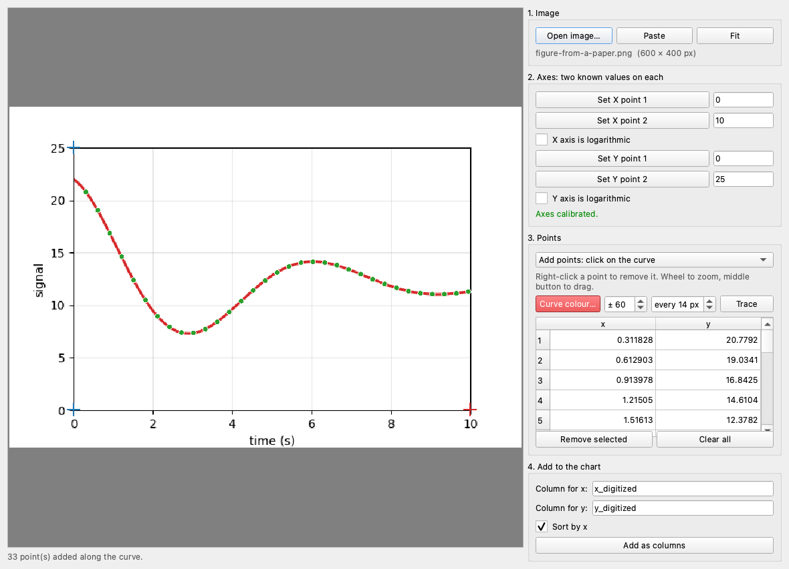

# Digitize Image

**Digitize Image** reads the values of a chart that exists only as a picture: a figure of a paper, a scan, a screenshot. You tell plotviz where two known values are on each axis, click on the curve (or let plotviz follow its colour), and the points become two columns of the chart, ready to plot or to fit.

Open it from the menu bar: **Tools → Digitize Image…** (`Ctrl + Shift + D`).

## Step by step

1. **Open the image.** Click **Open image…**, or copy the picture (from a PDF viewer, a web page) and click **Paste** (`Ctrl + V`). **Fit** shows the whole image.
2. **Calibrate the axes.** Click **Set X point 1**, then click on the image at a position of the X axis whose value you know, and type that value in the box beside the button. Do the same for **X point 2** and for the two points of the Y axis. The two points of an axis should be far apart (the ends of the axis are best), and need not be on the curve. The line **Axes calibrated** appears when the four points and the four values are set. Tick **logarithmic** for an axis with a log scale.
3. **Mark the curve.** With the tool **Add points**, click on the curve: each click adds a point. Right-click a point to remove it. The table shows the value of each point, and the bar under the image shows the values at the pointer.
4. **Add the points to the chart.** Type the names of the two columns and click **Add as columns**. They appear in the **Datasets** list like any other column (a name already in use gets a number).

Zoom with the mouse wheel and drag the image with the middle button, or choose the **Pan** tool and drag with the left button. Zooming in before clicking makes the points more exact.

## Following a curve by its colour

For a curve that is drawn with a colour that nothing else on the chart has, plotviz can place the points for you:

1. Click **Curve colour…**, then click on the curve. The button takes the colour.
2. Set the tolerance (**±**: how different from that colour a pixel may be) and the spacing (**every** *n* **px**: one point per this many columns of the picture).
3. Click **Trace**.

The search is limited to the area between the reference points of the two axes, so a legend or a title in the same colour outside it is ignored. If the grid, the legend inside the plot or another curve has a similar colour, lower the tolerance or remove the extra points by hand. Tracing adds to the points that exist; **Clear all** starts again.

## Accuracy

The result can be no better than the picture: a point is read to a pixel, so a small image gives coarse values. Use the largest version of the figure that you have. Changing the calibration values later moves every point, because the window keeps the pixel position of the points, not their values.

The picture must show the axes straight and square to the page. A chart that was photographed at an angle, or rotated, gives values that are wrong in a way that no calibration of two points can correct.

!!! note
    A figure that someone else published is still theirs: digitizing it to read the numbers is common practice, but cite the source when you reuse the data.
