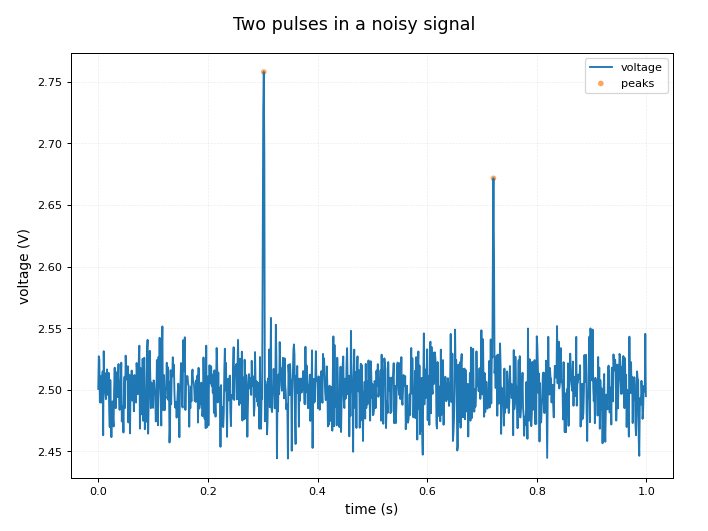
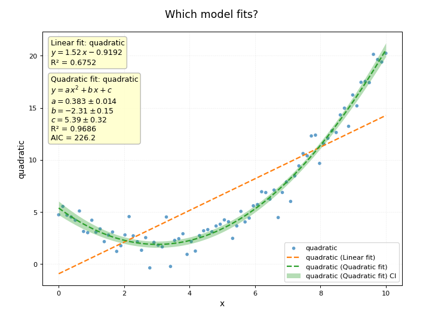
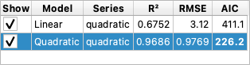
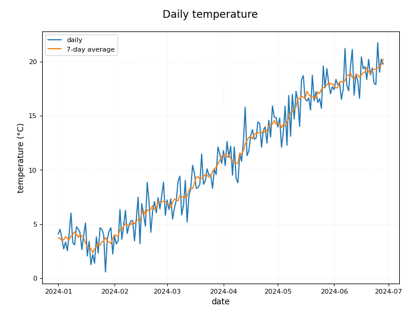

# Worked Examples

Three short walks through the app, from the data to the chart, with the sample files that come with plotviz (**Help → Sample Datasets…**, see [Menus](menus.md)). Each one uses pages that are described in the User Guide, so follow the links when you want the detail.

---

## Find the pulses in a noisy signal

**The data:** `pulse_signal.csv` has a reading in volts (`voltage`) taken every millisecond for one second. It is steady apart from the noise, and there are two short pulses hidden in it.

1. **Load it.** In **Data → Datasets**, click **Browse Files** and open `pulse_signal.csv`. Three columns appear in the list: `time_s`, `voltage` and `voltage_drift`.
2. **Plot it.** In **Plots → Plot**, set the first series row to **X** `time_s` and **Y** `voltage`, type **Line**. The pulses are tall but narrow, and the noise is a band about 0.1 V wide.
3. **Find the peaks.** In **Data → Transform** choose **x** `time_s`, **y** `voltage` and the operation **Find peaks** (under *Signal analysis*). Set **Min height (× noise)** to `5`: a point counts as a peak only if it rises at least five times the noise above the baseline. The **Preview** under the parameters draws the original with the peaks marked, and the line under it says what the result has: two points.
4. **Apply.** Click **Apply**. Two new series are created: `time_s_peaks` and `voltage_peaks`, with the time and the height of each peak.
5. **Show them on the chart.** In **Plots → Plot**, click **Add series**: **X** `time_s_peaks`, **Y** `voltage_peaks`, type **Scatter**.

The pulses are at 0.302 s (2.76 V) and 0.721 s (2.67 V). With the threshold at 5 × noise the filter does not mistake any of the noise for a peak; with no threshold it would report 332. If the signal drifts, use `voltage_drift` and remove the trend first (**Remove trend**, degree 1, fitting only a stretch that has no pulse); see [Transform](transform.md).

---

## Which curve fits best?

**The data:** `fit_test.csv` has many columns for trying fits; `quadratic` follows a parabola with noise.

1. **Load it** (**Data → Datasets → Browse Files**) and in **Plots → Plot** plot **X** `x` against **Y** `quadratic` as **Scatter**.
2. In **Plots → Curves**, choose the series in the **Per-curve** list, set **Model** to **Linear** and click **Apply Fit**.
3. Set **Model** to **Quadratic** and click **Apply Fit** again. Both fits stay on the chart and in the list of fits.
4. Set **Confidence limits** to **2σ (95%)** to draw the band of the selected fit.
5. Put the numbers on the chart: click **📝 Add to chart…** and choose what to show. Here the parabola is labelled with its parameters and AIC, and the line with the defaults (equation and R²).

The **Fits** list compares them:

The straight line explains 67.5 % of the variation (R² = 0.675); the parabola, 96.9 % (R² = 0.969). The **AIC** says the same in a fairer way, since a model with more parameters always fits a little better: the lowest value wins, here 226.2 for the quadratic (in bold) against 411.1 for the line. The line is plainly the wrong shape: it passes under the points at both ends and over them in the middle. More about the models, bands and comparing in [Curves and Fitting](curves.md).

---

## A daily series, smoothed

**The data:** `dates_daily.csv` has a `date` column and two readings, `temperature` and `sales`, for 180 days.

1. **Load it.** In the import dialog the `date` column is recognised as dates (it shows a calendar mark); leave it as it is. See [Datasets and Import](datasets.md#date-and-time-columns).
2. In **Plots → Plot**, set **X** `date`, **Y** `temperature`, type **Line**. The x axis shows dates: months, in this case.
3. In **Data → Transform** choose **x** `date`, **y** `temperature`, the operation **Moving average**, and **Window** `7`. The preview shows the weekly average over the daily points. Click **Apply**: the new series is `temperature_MA7`.
4. In **Plots → Plot**, click **Add series**: **X** `date`, **Y** `temperature_MA7`, **Line**. Give it the label `7-day average`, which is what the legend will say.

The daily readings jump about by several degrees, and the weekly average shows the climb underneath, from about 4 °C in the first week of January to about 19 °C in the last week of June. A date column keeps being a date after a transform that keeps x, so the axis stays a date axis. To read the trend as a number (degrees per day), fit a **Linear** model on `date` against `temperature`, as in the previous example; the date is counted in days, so the slope is per day.
