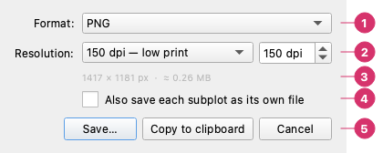

# Export Image

**File → Export Image…** (`Ctrl + E`, or **⬆ Export** in the top bar) writes the chart as a picture file. The file is made from the same figure as the preview, at the size you set in [Layout & Style](layout-style.md), so what you see is what you get. To keep the chart as a script instead, see [Python Export Bundle](python-export.md). To draw saved charts from a script, without opening the program, see [Command Line](command-line.md).

1. **Format** — **PNG**, **SVG**, **PDF**, **JPEG**, **TIFF** or **EPS**.
2. **Resolution** — a preset (96 dpi screen, 150 low print, 300 print, 600 hi-res) or any value from 36 to 1200 dpi. It is greyed out for the vector formats.
3. **Size in pixels** — the width and height of the picture and an estimate of the file size, which updates when you change the format or the resolution. For a vector format it says that the DPI is not applied.
4. **Each subplot** — also saves every subplot as a file of its own. It is available only when the chart has more than one subplot.
5. **Buttons** — **Save…** asks for the file name; **Copy to clipboard** puts the picture on the clipboard instead; **Cancel** closes the dialog.

---

## Choosing a format

| Format | Kind | Good for |
|--------|------|----------|
| **PNG** | Raster, lossless | Slides, web pages, documents; the default |
| **JPEG** | Raster, lossy | Photographs; not recommended for charts, whose sharp lines show artefacts |
| **TIFF** | Raster, lossless | Journals and publishers that ask for it |
| **SVG** | Vector | Editing in a drawing program (Inkscape, Illustrator); the web |
| **PDF** | Vector | LaTeX and Word documents; prints sharply at any size |
| **EPS** | Vector | Older publishing workflows |

Vector files have no resolution: they can be enlarged without losing sharpness, and the DPI box does not apply to them.

## Size and resolution

The size of the picture is the **figure size** of the Layout & Style tab (in centimetres, inches or pixels) times the resolution: a 20 × 15 cm figure at 300 dpi is 2362 × 1772 pixels. The dialog shows the result before you save.

For a paper or a report, set the figure to the width the journal or the template gives for a column (in **Layout & Style → Figure**), then export at 300 dpi or more, or as a vector. Font sizes are in points, so with the figure at its final width the text comes out at the size you chose.

## Copy to clipboard

**Copy to clipboard** is for raster formats (PNG, JPEG, TIFF): the picture is always copied as PNG, at the resolution in the dialog. The clipboard keeps pixels and not dpi, so the size at which it is pasted depends on the program you paste into. **Edit → Copy Image to Clipboard** (`Ctrl + Shift + C`) does the same without opening the dialog.

## Saving each subplot

With more than one subplot, tick **Also save each subplot as its own file** to get, besides the whole figure, one file per subplot (`name_1`, `name_2`, …).

- Each file keeps the proportions of its subplot. Raster files are scaled so that the longer side matches the longer side of the figure; vector files (SVG, PDF, EPS) keep the subplot's natural size.
- A subplot file includes its axis labels, twin axis, legend and colour bar, but not the figure title or a figure-wide legend.
- If files with those names already exist, you are asked before they are replaced.
