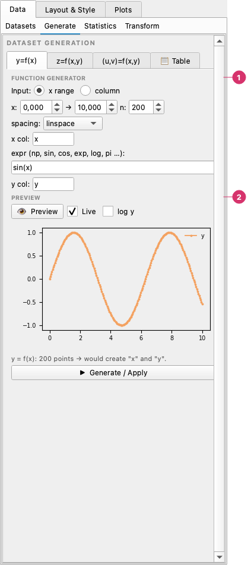
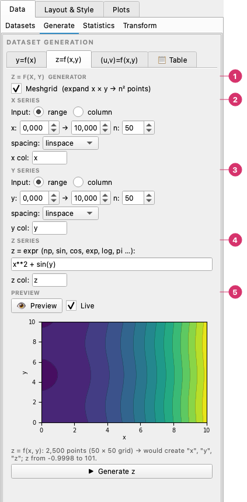
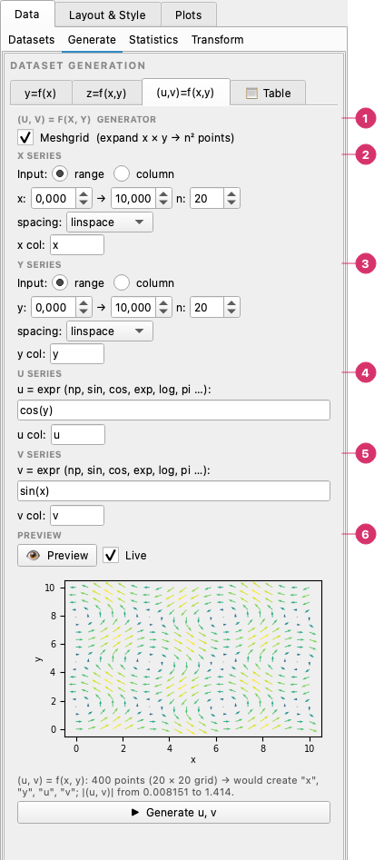
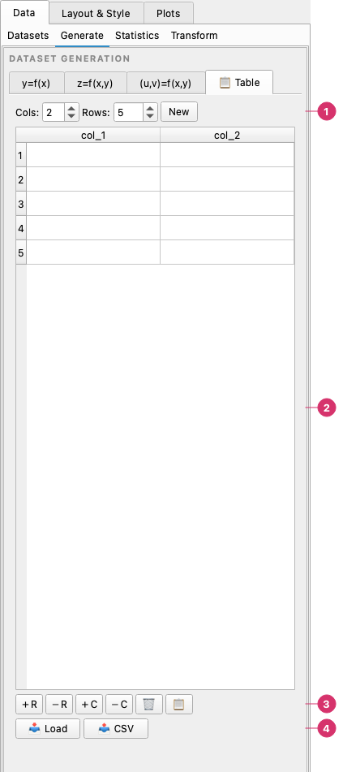

# Generate

The **Data → Generate** page creates series without loading a file: the **y=f(x)**, **z=f(x,y)** and **(u,v)=f(x,y)** generators, and the **Table** for typing values. To derive new series from loaded ones, see [Transform](transform.md).

---

## Function Generator

The function generator evaluates a mathematical expression over a range of X values and adds the result as a new dataset.



The **Generate** page, **y=f(x)**:

1. **Function generator** — The input is either an **x range** (from, to, number of points, spacing and the name of the x column) or an existing **column**; then the expression and the name of the y column. **Generate / Apply** at the bottom creates the columns.
2. **Preview** — What the button would create. See [Preview](#preview).

### Controls

| Control | Description |
|---------|-------------|
| **f(x)** | Python/NumPy expression — `x` is the independent variable array |
| **X min** | Start of the X range |
| **X max** | End of the X range |
| **N points** | Number of evenly spaced points in the range |
| **X col name** | Column name for the X dataset |
| **Y col name** | Column name for the generated Y dataset |

### Expression syntax

The expression field accepts any valid NumPy expression. The variable `x` is a NumPy array. Common functions available without a prefix:

```
sin(x)          cos(x)          tan(x)
exp(x)          log(x)          log10(x)
sqrt(x)         abs(x)          sign(x)
pi              e
```

Examples:

```
sin(x) * exp(-0.1 * x)
x**2 - 3*x + 2
log(x + 1) / (1 + cos(x))
```

### Workflow

1. Enter an expression in the **f(x)** field.
2. Set the X range and number of points.
3. Name the X and Y columns.
4. Click **Generate** — the columns appear in the Datasets list and can be assigned to series in **Plots → Plot**.

Clicking **Generate** again with the same column names does not replace the previous data: the new columns get a numeric suffix (`x_1`, `y_1`, …).

### Preview

Below the expression, a small plot shows what **Generate** would create, without creating anything. It uses the same calculation as the button, so what you see is what you get.

- **Preview** draws it once. **Live** (on by default) redraws shortly after any change: expression, range, number of points, spacing or names.
- With the **column** input, the source column is drawn in grey and the result over it.
- `logspace` and `geomspace` get a logarithmic x axis; **log y** is optional.
- With `random` or `uniform` spacing the preview keeps the same random draw until you click **Generate**, and the columns created are exactly the ones shown. The next preview is a new draw.
- Problems (syntax errors, unknown names, an empty range) are written in the plot area instead of showing a dialog.
- A line under the plot gives the number of points and the names of the columns that would be created. Above 50,000 points Live pauses; use **Preview**.

---

## z = f(x, y) and (u, v) = f(x, y)

The other two pages of the generator evaluate an expression of two variables, `x` and `y`, for the **z** column of a surface, or two expressions, `u` and `v`, for the components of a vector field.



The **z=f(x,y)** page:

1. **z = f(x, y) generator** — **Meshgrid** combines every x with every y.
2. **x series** — A generated range (with its spacing) or an existing column, and the name of the variable.
3. **y series** — The same for y.
4. **z series** — The expression, written with the two variables, and the name of the z column.
5. **Preview** — The field as contours, or as points when Meshgrid is off.



The **(u,v)=f(x,y)** page has the same x and y series, and an expression for each component:

1. **(u, v) = f(x, y) generator** — **Meshgrid** combines every x with every y.
2. **x series** — A generated range or an existing column.
3. **y series** — The same for y.
4. **u series** — The expression and the name of the horizontal component.
5. **v series** — The expression and the name of the vertical component.
6. **Preview** — The vector field as arrows.

- Each axis is its own choice: a generated **range** (with its spacing) or an existing **column**, used as it is.
- **Meshgrid** combines every x with every y (nx × ny points), which is what heatmaps, contours, surfaces and vector fields need. Without it, x and y are paired point by point.
- The columns created are x and y (only when generated, or with a meshgrid) and z, or u and v. Names already in use get a numeric suffix.

### Preview

Both pages have the same **Preview** and **Live** as the function generator, and the plot shows what the button would create without creating anything:

- **z**: a meshgrid as filled contours with their lines, otherwise coloured points (x and y paired one by one). The line under the plot gives the range of z.
- **(u, v)**: arrows coloured by their length, at most 20 per side on a grid. The line gives the range of the length.
- Random and uniform spacing keep their draw until you click the button, and x and y are different draws.

---

## Data Table

The data table provides a manual spreadsheet-style entry grid for small datasets.



The **Table** page has four zones:

1. **New table** — set the number of columns (**Cols**) and rows (**Rows**) and click **New**.
2. **Cells** — type or paste the values; double-click a column header to rename it.
3. **Editing buttons** — the buttons below the table.
4. **Load and CSV** — bring a file into the table, or copy the table out.

The editing buttons: **+R**, **−R**, **+C** and **−C** add and remove rows and columns, the bin button clears it, the clipboard button pastes CSV text, **Load** opens a CSV or Excel file into the table and **CSV** copies the table to the clipboard as CSV. The sections below explain each one.

### Creating a table

1. Set the **Cols** and **Rows** spinboxes.
2. Click **New** to create a blank table.
3. Click any cell and type to enter values.
4. Double-click a column header to rename it.

### Editing

| Button | Action |
|--------|--------|
| **＋R** | Add a row at the bottom |
| **－R** | Delete selected rows (or the last row if none selected) |
| **＋C** | Add a column on the right |
| **－C** | Delete the rightmost column |
| **🗑** | Clear all cell contents |

### Importing data

- **📋 (Paste)** — paste tab- or comma-separated text from the clipboard directly into the table.
- **📥 Load** — open a CSV or Excel file; its contents fill the table.

### Exporting

- **📤 CSV** — copies the entire table as CSV text to the clipboard, ready to paste into another application.

### Using the table data

Click **Apply to chart** (or the equivalent generate button depending on the UI layout) to load the table's columns into the Datasets list. They become available in the series table X/Y dropdowns just like data loaded from a file.

Column names are taken from the table headers. Values that cannot be parsed as numbers are treated as categorical strings.
