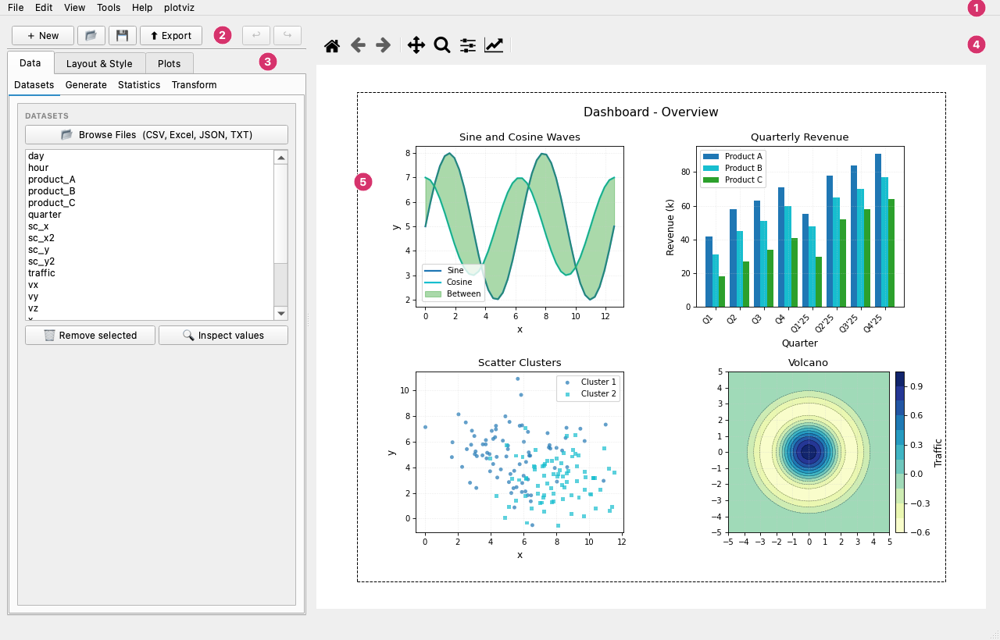

# Getting Started

## Requirements

- Python 3.10 or later
- macOS 11+, Windows 10+, or Linux (X11/Wayland)

## Installation

### Pre-built binary (recommended — no Python required)

Download the latest release for your platform from GitHub:

[macOS DMG / Windows ZIP → GitHub Releases](https://github.com/pcachim/plotviz/releases/latest)

- **macOS** — open the `.dmg`, drag `plotviz.app` to Applications.
- **Windows** — extract the `.zip` and run `plotviz.exe`.

### From PyPI

```bash
pip install plotviz
```

### From source (recommended for development)

```bash
git clone https://github.com/pcachim/plotviz.git
cd plotviz
uv sync          # installs all dependencies into .venv
uv run plotviz   # launches the app
```

### Dependencies

plotviz installs these packages automatically:

| Package | Version | Purpose |
|---------|---------|---------|
| PyQt6 | ≥ 6.5 | UI framework |
| matplotlib | ≥ 3.7 | Chart rendering |
| seaborn | ≥ 0.13 | Statistical charts |
| numpy | ≥ 1.24 | Numerical arrays |
| pandas | ≥ 2.0 | Data loading |
| scipy | ≥ 1.10 | Curve fitting and statistics |
| statsmodels | ≥ 0.14 | Regression and LOWESS |
| openpyxl | ≥ 3.1 | Excel file support |
| platformdirs | ≥ 3.0 | Settings directory |

---

## Launching

```bash
# if installed via pip
plotviz

# from source with uv
uv run plotviz

# open a file directly
plotviz mydata.pviz
```

You can also double-click a `.pviz`, `.pvizt`, `.pvizc` or `.pvizp` file in Finder (macOS) or Explorer (Windows) once the app is installed.

---

## Interface overview



The window has five zones:

1. **Menu bar** — **File** (open, save, export), **Edit** (undo, redo, copy the chart as an image), **View**, **Tools** and **Help**. On macOS, *About* and *Preferences* are under the **plotviz** menu.
2. **Top bar** — **New**, **Open**, **Save**, **Export**, and **Undo** / **Redo** for the last changes.
3. **Panel tabs** — **Data**, **Layout & Style** and **Plots**: all the settings of the chart. Each has its own pages, described in the User Guide.
4. **Canvas toolbar** — The matplotlib tools for the preview: home, back and forward, pan, zoom and the others.
5. **Chart preview** — The chart as it will be exported. It redraws as you change settings. The dashed rectangle is the edge of the page (the figure size set in **Layout & Style**).

The plotviz window has two main areas:

**Left panel — tabs**

| Tab | Purpose |
|-----|---------|
| Data | Loaded datasets, and the **Generate**, **Statistics** and **Transform** pages |
| Layout & Style | Whole-figure settings: size, margins, title, subplot grid, colour scheme, palette |
| Plots | Per-subplot settings, with a **Editing** selector at the top when there are several subplots |

The **Plots** tab has five pages: **Plot** (chart type, series table, options), **Curves** (per-curve line style, marker, colour, curve fitting), **Axes** (subplot title, axis labels, limits, scales, ticks, secondary Y axis, Z axis and 3D viewpoint), **Canvas & Grid** (plot-area colour, borders, major and minor grid) and **Legend & Notes** (legend, text/arrow/image annotations). Opening, saving and exporting are in the **File** menu.

**Right panel — canvas**

The live chart preview updates as you change settings. Use the matplotlib toolbar at the top of the canvas to pan, zoom, and reset the view.

---

## Your first chart

### 1. Load data

Click the **Data** tab → **Browse Files** and open a CSV, Excel, JSON or TXT file. (No data of your own yet? **Help → Sample Datasets…** loads one of the samples, and **Help → Sample Charts…** opens ready-made charts; see [Menus](menus.md).) plotviz reads all numeric and categorical columns and lists them in the dataset panel.

### 2. Assign columns to series

In **Plots → Plot**, in the series table, use the **X** and **Y** dropdowns to pick which columns to plot. The **Label** column sets the legend entry. Add more rows with the **+ Add series** button.

### 3. Choose a chart type

In **Plots → Plot**, select a chart type from the dropdown — Line, Scatter, Bar, and so on. The canvas updates instantly.

### 4. Style the chart

- **Layout & Style** tab: set background color, colour scheme, figure size.
- **Plots → Curves**: change line color, width, marker style.
- **Plots → Axes**: set axis labels, limits, scale, grid and canvas colours.
- **Plots → Legend & Notes**: add a legend or text annotations. The subplot title is in **Plots → Axes**.

### 5. Export

Click **⬆ Export** in the top bar (or **File → Export Image…**, `Ctrl + E`), pick a format and a resolution, and **Save…** (or **Copy to clipboard**). The size is the figure size set in the Layout & Style tab. The formats, the resolution, copying to the clipboard and saving each subplot are explained in [Export Image](export.md).

### 6. Save your work

Click the save button in the top bar (or **File → Save Chart**, `Ctrl + S`) to save a `.pviz` project file. Reopening it restores your data, series assignments, and all style settings.

Made a mistake? **Edit → Undo** (`Ctrl + Z`) steps back through your last changes; see [Undo and redo](shortcuts.md#undo-and-redo).

---

## Settings and preferences

plotviz stores user preferences in a JSON file:

| Platform | Location |
|----------|----------|
| macOS | `~/Library/Application Support/plotviz/settings.json` |
| Linux | `~/.config/plotviz/settings.json` |
| Windows | `%APPDATA%\plotviz\settings.json` |

Stored preferences include the last-used directory, theme (System/Light/Dark), recent files list (up to 12), recent colors; your colour schemes and palettes are files in the `schemes` and `palettes` folders beside it, and window geometry.

### Appearance (light and dark)

The **Colour scheme** dropdown in the Preferences window (**plotviz → Preferences…** on macOS, **Edit → Settings…** on Windows and Linux) controls the application's light and dark mode:

- **System** — follows the OS theme (default).
- **Light** — forces the light theme.
- **Dark** — forces the dark theme.

This changes the application only, not the chart colours, which are set with [Color Schemes](color-schemes.md) and the Layout & Style tab.

To reset all settings to defaults, delete the `settings.json` file and restart the app.
