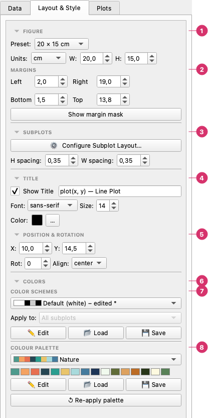

# Layout & Style

The **Layout & Style** tab controls the figure as a whole: size, margins, title, subplot layout, colour scheme and palette. The plot area, borders and grid of each subplot are on the **Plots → Canvas & Grid** page.

## The Layout & Style tab

From top to bottom:

1. **Figure** — The page: a **preset** or your own **width** and **height**, in the unit you choose.
2. **Margins** — The distance from the page edge to the plot area, in the same unit. **Show margin mask** shades the margins on the preview.
3. **Subplots** — **Configure Subplot Layout…** opens the grid and mosaic dialog; **H spacing** and **W spacing** set the gaps between panels.
4. **Title** — Show or hide the chart title, its text, font, size and colour.
5. **Position & rotation** — Where the title sits on the page (**X**, **Y**), its **rotation** and its **alignment**.
6. **Colors** — The colour settings of the whole figure: the two sections below.
7. **Color schemes** — The scheme (backgrounds, text, grid, borders) and, with several subplots, whether it **applies** to all of them or to one. **Edit**, **Load** and **Save** manage your own.
8. **Colour palette** — The colours given to the curves in order. **Edit**, **Load** and **Save** manage your own palettes; **Re-apply palette** gives the curves the palette colours again.

---

## Figure size

| Control | Description |
|---------|-------------|
| **Preset** | Quick size: A4 landscape, Letter, 20×15 cm (default), 16×9 widescreen, square |
| **Unit** | cm, inches, or px |
| **Width / Height** | Exact dimensions in the chosen unit |

The size set here is used for both the live preview and the exported file.

### Margins

Four boxes — **Left, Right, Bottom, Top** — give the distance from the page edge to the plot area, in the unit chosen above. The defaults leave room for axis labels and the title. **Show margin mask** shades the margins on the preview so you can see what they control.

### DPI

The resolution of exported PNG and JPEG files is chosen in the **Export** dialog. SVG and PDF are vector formats and ignore it.

---

## Related pages

- [Subplots](subplots.md) — the grid and mosaic dialog behind **Configure Subplot Layout…**.
- [Color Schemes](color-schemes.md) and [Color Palettes](palettes.md) — the **Colors** section.
- [Axes](axes.md) — the title of each subplot and the axis labels.
- [Canvas & Grid](canvas-grid.md) — the plot area, borders and grid of each subplot.
