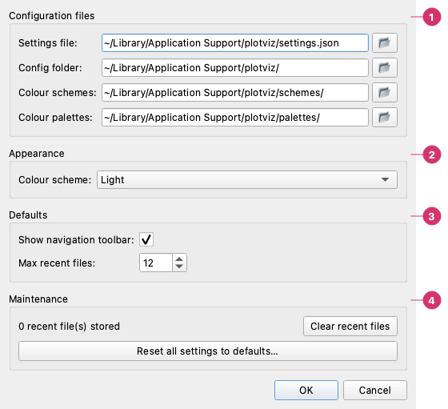

# Menus

Everything the menu bar does, with its shortcut. The shortcuts are also in [Keyboard Shortcuts](shortcuts.md). On macOS, **About** and **Preferences** are under the **plotviz** menu; on Windows and Linux, **Settings…** is at the end of **Edit** and **About plotviz** at the end of **Help**.

---

## File

| Item | Shortcut | What it does |
|------|----------|--------------|
| **New Chart** | `Ctrl + N` | Starts an empty chart |
| **Open Chart…** | `Ctrl + O` | Opens a chart file (`.pviz`) with its data and settings |
| **Open Recent** | | The charts you opened or saved last; how many are kept is set in [Preferences](#preferences) |
| **Load Template…** | | Applies the style and layout of a template (`.pvizt`) to the current chart, without data |
| **Load Palette…** | | Loads a colour palette file (`.pvizp`); see [Color Palettes](palettes.md) |
| **Load Scheme…** | | Loads a colour scheme file (`.pvizc`); see [Color Schemes](color-schemes.md) |
| **Load Data…** | `Ctrl + L` | Opens the import dialog for CSV, Excel, JSON or text files; see [Datasets and Import](datasets.md) |
| **Save Chart** | `Ctrl + S` | Saves the open chart (asks where the first time) |
| **Save Chart As…** | `Ctrl + Shift + S` | Saves it under another name |
| **Save Template…** | | Saves the style and layout without the data |
| **Save Palette…** | | Saves the current colour palette |
| **Save Scheme…** | | Saves the current colour scheme |
| **Export Image…** | `Ctrl + E` | Writes the chart as PNG, SVG, PDF, JPEG, TIFF or EPS, or copies it to the clipboard; see [Export Image](export.md) |
| **Export Python Bundle…** | `Ctrl + Shift + E` | Writes a standalone Python script of the chart; see [Python Export Bundle](python-export.md) |

The file types are described in [File Formats](file-formats.md).

---

## Edit

| Item | Shortcut | What it does |
|------|----------|--------------|
| **Undo** | `Ctrl + Z` | Undoes the last change; see [Undo and redo](shortcuts.md#undo-and-redo) |
| **Redo** | `Ctrl + Y` | Redoes it |
| **Copy Image to Clipboard** | `Ctrl + Shift + C` | Copies the chart as an image, to paste into another program |
| **Settings…** (Windows, Linux) | `Ctrl + Alt + S` | The [Preferences](#preferences) |

---

## View

**Data**, **Layout & Style** and **Plots** switch the tab of the left panel (the same as clicking it).

---

## Tools

| Item | Shortcut | What it does |
|------|----------|--------------|
| **Seaborn Explorer…** | `Ctrl + Shift + B` | The window for statistical charts; see [Seaborn Explorer](seaborn-explorer.md) |
| **Python Code Runner…** | `Ctrl + Shift + P` | The editor for your own matplotlib code; see [Python Code Runner](code-runner.md) |
| **Code Runner from chart** | `Ctrl + Shift + R` | Opens the Code Runner with the script of the current chart, already run |

---

## Help

| Item | Shortcut | What it does |
|------|----------|--------------|
| **Documentation** | `F1` | This documentation, in a window of its own, without a network connection |
| **Documentation Online** | | The same documentation on the website |
| **Sample Charts…** | | A file dialog in your samples folder: pick a ready-made chart to open |
| **Sample Datasets…** | | A file dialog in your sample datasets folder: pick one or more files to load |
| **About plotviz** | | The version, the copyright and the licence |

The samples are copies of the examples that come with plotviz, made the first time it runs, so you can open and change them freely. They live in the `plots` and `datasets` folders of the config folder shown in the Preferences. (A `pip` install does not include them; the binary releases and a source checkout do.) The sample charts cover each chart type; the sample datasets are the data behind them, and some more to try the Generate, Transform and Statistics pages (`pulse_signal.csv`, `fit_test.csv`, `dates_daily.csv`…).

---

## Preferences

**plotviz → Preferences…** (`Ctrl + ,`) on macOS, **Edit → Settings…** (`Ctrl + Alt + S`) on Windows and Linux.

1. **Configuration files** — Where plotviz keeps the settings file, the config folder, and the folders of your colour schemes and palettes. A button next to each opens its folder.
2. **Appearance** — **Colour scheme**: System, Light or Dark. It is applied at once, and **Cancel** puts it back.
3. **Defaults** — **Show navigation toolbar** (the matplotlib toolbar above the chart) and **Max recent files** (1 to 30).
4. **Maintenance** — **Clear recent files**, and **Reset all settings to defaults…**, which does not touch your charts or data.
