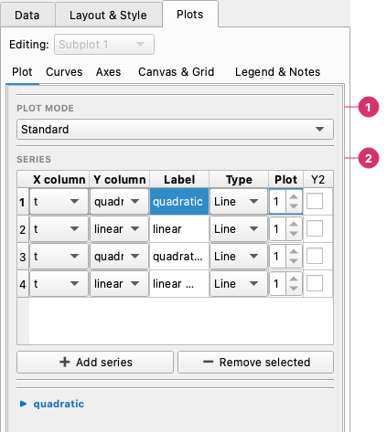

# Plot: Series and Chart Types

The **Plots → Plot** page decides what is drawn: which columns, as which chart type, in which subplot. Everything else about how it looks is on the other pages of the **Plots** tab.

---

## The series table

The series table is on the **Plots → Plot** page:

1. **Plot mode** — Which group of chart types the subplot uses: Standard, Histogram, Statistical, Heatmap & Contour, Polar & Radar, Pie or Quiver.
2. **Series** — One row per plotted series: the **X** and **Y** columns, the legend **Label**, the chart **Type**, the number of the subplot it belongs to (**Plot**) and whether it uses the secondary axis (**Y2**). **Add series** and **Remove selected** change the rows. Below the table, the options of the selected series appear.

| Column | Purpose |
|--------|---------|
| **X** | Column used as the horizontal axis values |
| **Y** | Column used as the vertical axis values |
| **Label** | Text shown in the chart legend |
| **Type** | Chart type for this series (Line, Scatter, Bar, …) |
| **Plot** | Which subplot panel this series appears in (1-based) |
| **Y2** | Checkbox — plots this series on the secondary Y axis |

### Adding and removing series

- **+ Add series** — appends a new row with empty column selections.
- **− Remove selected** — removes the selected rows.

### Mixing chart types

Each row in the series table has its own **Type** dropdown, so you can mix chart types within the same panel — for example, a Line series and a Scatter series sharing the same axes.

Types that take over the whole chart (Histogram, Pie, Heatmap, etc.) cannot be mixed with other types in the same subplot.

### Secondary Y axis (Y2)

Tick the **Y2** checkbox on any series row to plot it against a second Y axis on the right side of the chart. The Y2 axis label is set in the **Axes** tab.

### Z column and error column

Below the series table are two extra dropdowns:

- **Z** — used by Heatmap, Hist2D, Hexbin, Contour, and Bubble charts as the third data dimension.
- **Error** — used by the Errorbar chart as the error/uncertainty values.

---

## Chart type selection

The **Plot mode** dropdown at the top of **Plots → Plot** chooses a group of chart types for the subplot: Standard, Histogram, Statistical, Heatmap & Contour, Polar & Radar, Pie or Quiver. The **Type** cell of each series offers the types of that group.

In **Standard** the type belongs to each series, so they can be mixed; the other groups draw the whole panel as one chart.

See [Chart Types](chart-types.md) for a full description of every chart type and its options.
