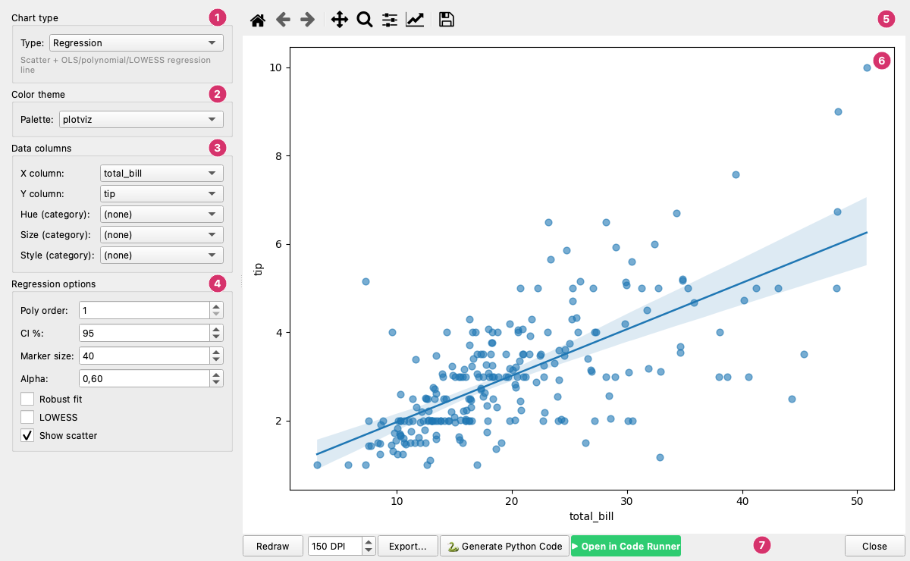
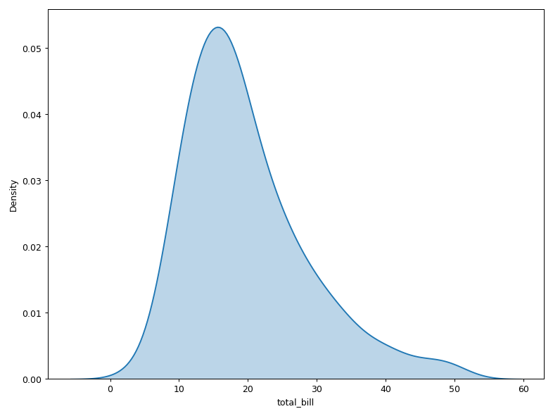
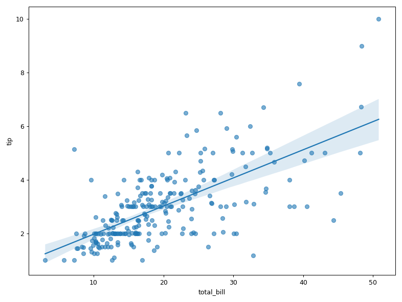
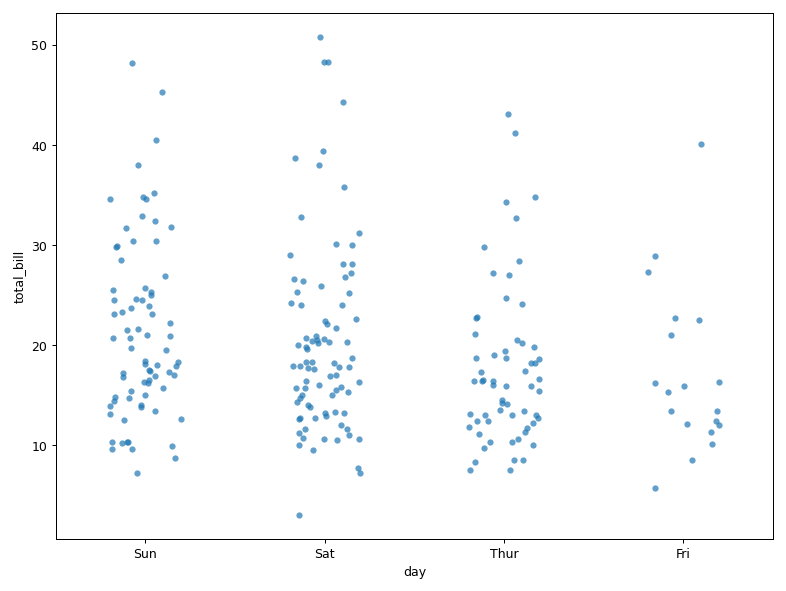
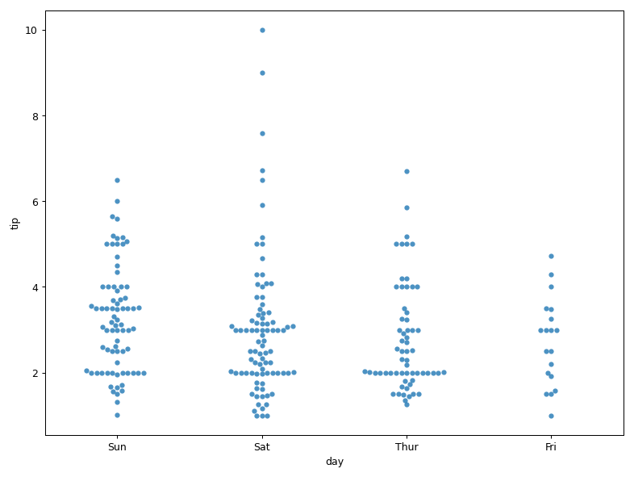
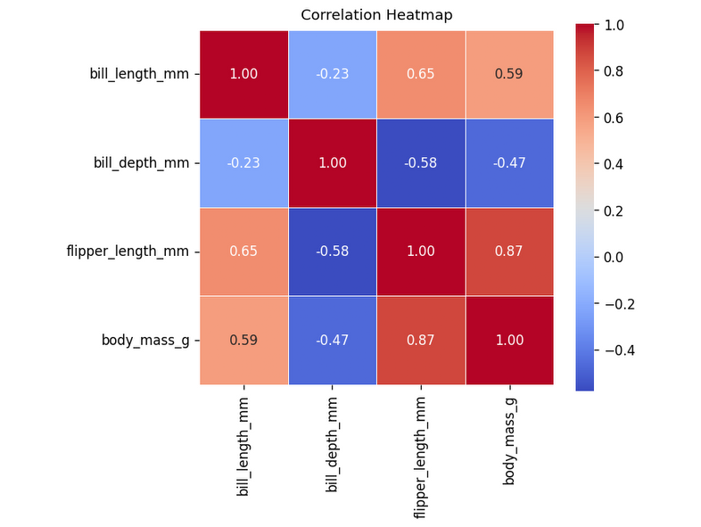
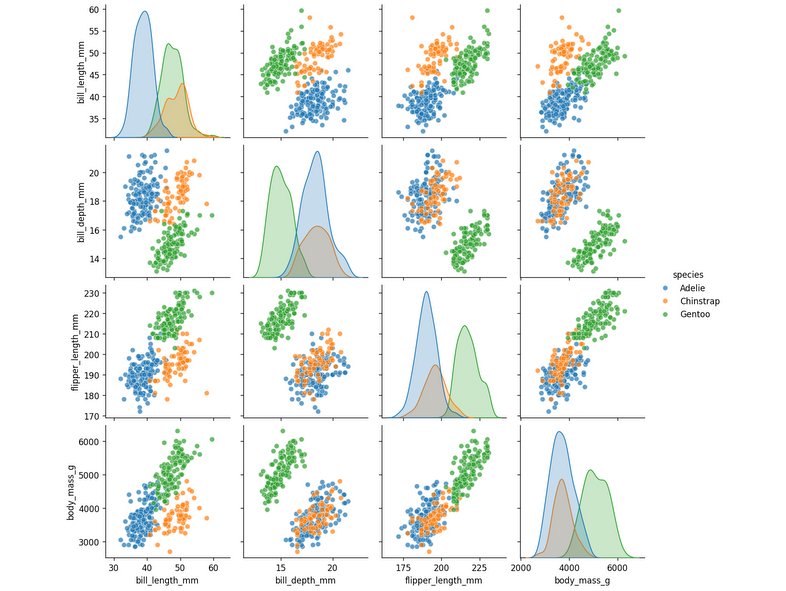
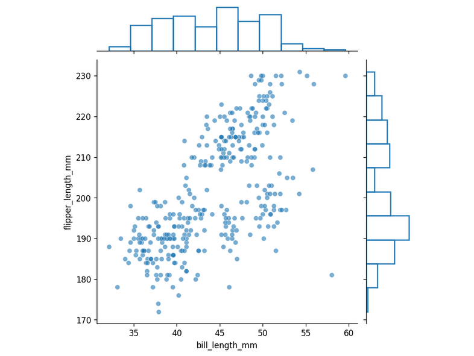
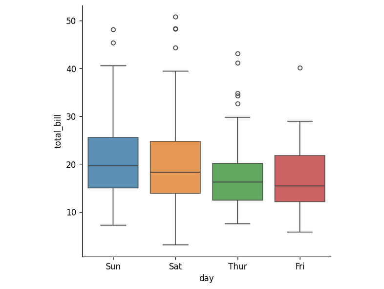

# Seaborn Explorer

The **Seaborn Explorer** is a dedicated dialog for creating statistical charts powered by [seaborn](https://seaborn.pydata.org/). It runs on its own canvas, fully isolated from the main plotviz chart, so figure-level seaborn plots (Pairplot, Joint, Heatmap, Catplot) never interfere with the main chart's style pipeline.

Open it from the menu bar: **Tools → Seaborn Explorer…**

!!! note "Requirements"
    Seaborn must be installed: `pip install seaborn`. Some regression options (Robust fit, LOWESS) additionally require `pip install statsmodels`.

---

## Interface

The window, from left to right and top to bottom:

1. **Chart type** — One of the eight types below; a line under the box describes it.
2. **Color theme** — The palette: **plotviz** uses the palette of the current chart, the others are seaborn palettes.
3. **Data columns** — The columns for X, Y and, for some types, **Hue**, **Size** and **Style**. Heatmap and Pairplot show a list of columns to pick instead.
4. **Chart options** — The options of the chosen type. This box changes with the type (see below).
5. **Canvas toolbar** — The matplotlib tools: home, back and forward, pan, zoom, subplot settings, axis editor and save.
6. **Preview** — The chart. Changes to the controls are drawn when you click **Redraw**.
7. **Bottom bar** — **Redraw**, the export **DPI**, **Export…**, **Generate Python Code**, **Open in Code Runner** and **Close**.

The window has two panels:

| Panel | Contents |
|-------|----------|
| **Left — controls** | Chart type, color theme, column selectors, and chart-specific options |
| **Right — preview** | Live seaborn canvas with navigation toolbar and export controls |

Changes to the controls do **not** redraw automatically — click **Redraw** to apply them.

---

## Chart types

| Type | Description |
|------|-------------|
| **KDE** | Kernel Density Estimate — smoothed distribution curve |
| **Regression** | Scatter plot with OLS, polynomial, or LOWESS regression line |
| **Strip** | Categorical scatter plot with jitter |
| **Swarm** | Categorical beeswarm plot (non-overlapping points) |
| **Heatmap** | Correlation matrix heatmap |
| **Pairplot** | All-vs-all scatter grid (uses column picker) |
| **Joint** | Bivariate joint distribution with marginals |
| **Catplot** | Figure-level categorical chart (box, violin, bar, strip, and more) |

### What each type draws

The pictures use the `tips` and `penguins` sample datasets of the seaborn collection (in the `seaborn` folder of the sample datasets).

**KDE** — the smoothed distribution of one column (here `total_bill`).

**Regression** — `tip` against `total_bill`, with the fitted line and its 95 % confidence band.

**Strip** — `total_bill` for each `day`, one dot per bill, spread sideways (jitter) so they do not hide each other.

**Swarm** — `tip` for each `day`, with the dots moved aside so that none overlaps.

**Heatmap** — the correlation between the numeric columns of the penguins sample, with the values written in the cells (**Annotate**).

**Pairplot** — every pair of the numeric columns, coloured by `species` (**Hue**).

**Joint** — `flipper_length_mm` against `bill_length_mm`, with the distribution of each at the sides.

**Catplot** — a box plot of `total_bill` by `day` (**Kind**: box; the other kinds are boxen, violin, bar, point, count, strip and swarm).

---

## Data columns

For chart types that use X/Y axes (KDE, Regression, Strip, Swarm, Joint, Catplot), select columns from the dropdowns:

| Dropdown | Accepts |
|----------|---------|
| **X column** | Any loaded column (numeric or categorical) |
| **Y column** | Numeric columns only |
| **Hue (category)** | Categorical columns — splits data into color groups |
| **Size (category)** | Categorical columns — varies marker size by group |
| **Style (category)** | Categorical columns — varies marker shape/line style by group |

For **Heatmap** and **Pairplot**, a multi-select column list replaces the X/Y dropdowns. Use **All** / **None** buttons to quickly select or deselect all numeric columns.

---

## Color theme

The **Palette** dropdown controls the color scheme used for all chart types. The first option, **plotviz**, applies your current plotviz color palette. All other options are standard seaborn/matplotlib named palettes:

`deep`, `muted`, `pastel`, `bright`, `dark`, `colorblind`, `tab10`, `Set1`, `Set2`, `Set3`, `Paired`, `husl`, `hls`, `rocket`, `mako`, `flare`, `crest`, `viridis`, `plasma`, `magma`, `inferno`

---

## Chart-specific options

### KDE options

| Option | Description |
|--------|-------------|
| **Fill alpha** | Opacity of the shaded area under the curve (0–1) |
| **Line width** | Thickness of the KDE line |
| **BW adjust** | Bandwidth smoothing multiplier (higher = smoother) |
| **Fill** | Toggle the shaded fill under the curve |
| **Cumulative** | Show the cumulative distribution instead |
| **Common norm** | Normalize across all hue groups (areas sum to 1 globally) |

### Regression options

| Option | Description |
|--------|-------------|
| **Poly order** | Polynomial degree for the regression line (1 = linear) |
| **CI %** | Confidence interval width (0–99%) |
| **Marker size** | Scatter point size |
| **Alpha** | Scatter point opacity |
| **Robust fit** | Use robust regression (requires statsmodels) |
| **LOWESS** | Non-parametric locally-weighted smoothing (requires statsmodels) |
| **Show scatter** | Toggle the underlying scatter points |

!!! note
    Robust fit and LOWESS are mutually exclusive with each other and with polynomial order > 1.

#### Regression here and in Curves

The Explorer draws a **trend line over the points**, to look at them. The curve fit of **Plots → Curves** (see [Curves and Fitting](curves.md)) **fits a model** that you can read numbers from, compare and keep with the chart. They are not two versions of the same tool:

| | **Explorer → Regression** | **Plots → Curves → Curve fit** |
|---|---|---|
| **What it is** | A picture for exploring the data | A fit that is stored in the chart |
| **Models** | A line or a polynomial (order 1 to 6), a robust line, or LOWESS | Linear, polynomial up to degree 10, exponential (with or without an offset), power, logarithmic, sigmoid, Gaussian, sinusoid, your own expression, and LOWESS |
| **Band** | **CI %** (95 by default), found by resampling the data at random; it is not drawn for a robust fit or for LOWESS | **Confidence limits** and **Prediction band**, at 1, 2 or 3 sigma, calculated from the uncertainty of the parameters |
| **Numbers** | None | The equation, the parameters with their errors, R², adjusted R², RMSE, AIC, BIC and, for the models where it applies, an F-test; they can be exported to a text file |
| **Outliers** | *Robust fit* lessens their weight | *Robust* lessens their weight and **marks** the points that stand out, counting them in the results |
| **Part of the data** | All the points | **Fit only x from … to …** fits one stretch |
| **Weights** | No | **Weight by the error column** |
| **Comparing** | No: **Redraw** replaces the chart | The **Fits** list keeps several fits of a series, with R² and AIC side by side |
| **Where it lives** | In the Explorer window; it leaves as an image or as a script | On the main chart, saved in the `.pviz` and in the exported script |
| **New data** | None | New series with the curve and the bands, which can be drawn or transformed |

When to use which: the Explorer to see quickly whether there is a trend, or for a fast figure with the seaborn look; Curves when you need a value (the slope and its uncertainty), want to compare models, fit only part of the data, or keep the fit with the chart.

Two details. The straight line is the same in both (a least-squares line), but the Explorer's band comes from random resampling, so it changes a little each time the chart is redrawn, whereas the band of Curves is calculated and always the same. And **LOWESS** is in both only to *show* a trend, with no equation: in the Explorer it is drawn over the points, in Curves it joins the **Fits** list and is saved with the chart.

### Strip options

| Option | Description |
|--------|-------------|
| **Marker size** | Point size |
| **Alpha** | Point opacity |
| **Jitter** | Amount of random horizontal spread to reduce overplotting (0–0.5) |

### Swarm options

| Option | Description |
|--------|-------------|
| **Marker size** | Point size |
| **Alpha** | Point opacity |

### Heatmap options

| Option | Description |
|--------|-------------|
| **Colormap** | Color scale (`coolwarm`, `viridis`, `plasma`, `RdBu`, `Blues`, `Reds`, `YlOrRd`, `magma`, `rocket`, `mako`) |
| **Format** | Number format for cell annotations (`.2f`, `.1f`, `.0f`, `.2g`, `d`, or blank) |
| **Line width** | Width of the cell border lines |
| **Annotate cells** | Show correlation values inside each cell |
| **Square cells** | Force square cell aspect ratio |
| **Show colorbar** | Show the color scale legend |
| **Robust scale** | Use percentile-based color mapping to reduce outlier influence |

### Pairplot options

| Option | Description |
|--------|-------------|
| **Diagonal** | Plot type for the diagonal (auto, hist, kde) |
| **Off-diagonal** | Plot type for off-diagonal cells (scatter, kde, hist, reg) |
| **Alpha** | Point opacity |

### Joint plot options

| Option | Description |
|--------|-------------|
| **Kind** | Joint plot type (scatter, kde, hist, hex, reg, resid) |
| **Alpha** | Opacity |
| **Ratio** | Size ratio of the joint plot to the marginal plots |
| **Marginal KDE fill** | Fill the marginal KDE distributions |

### Catplot options

| Option | Description |
|--------|-------------|
| **Kind** | Categorical plot type (box, boxen, violin, bar, point, count, strip, swarm) |
| **Alpha** | Opacity |
| **Saturation** | Color saturation (0.1–1.0) |
| **CI** | Confidence interval for bar/point plots (95, 99, sd, or None) |
| **Dodge groups** | Separate hue groups side-by-side instead of overlapping |

---

## Canvas controls

The matplotlib navigation toolbar above the preview canvas provides pan, zoom, and reset controls. See [Keyboard Shortcuts](shortcuts.md#canvas-matplotlib-toolbar) for details.

---

## Bottom bar

| Button | Description |
|--------|-------------|
| **Redraw** | Re-render the chart with the current control values |
| **DPI spinner** | Export resolution (72–600 DPI) |
| **Export…** | Save the chart as PNG, SVG, PDF, or JPEG |
| **🐍 Generate Python Code** | Show a standalone Python script that reproduces the current chart |
| **▶ Open in Code Runner** | Export the chart as a `.pvizx` bundle and open it in the [Python Code Runner](code-runner.md) |
| **Close** | Close the Seaborn Explorer |

---

## Generating Python code

Click **🐍 Generate Python Code** to view a standalone Python script that reproduces the current seaborn chart without any dependency on plotviz. You can copy and paste this script into any Python environment.

Click **▶ Open in Code Runner** to send the chart directly to the [Python Code Runner](code-runner.md), where you can edit and re-run the generated code interactively.
