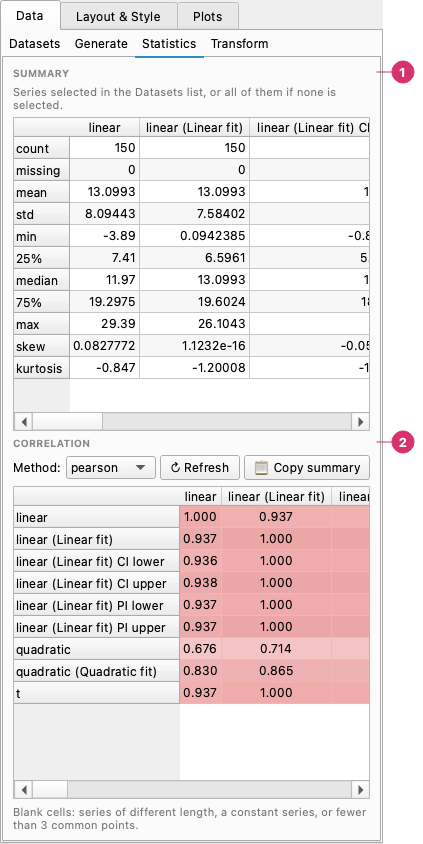

# Statistics

The **Data → Statistics** page summarises the loaded series. To create new series from them, see [Transform](transform.md).

## The Statistics page

The Statistics page summarises the loaded series. It works on the series **selected in the Datasets list**, or on all of them when none is selected. It refreshes when you open the page; click **↻ Refresh** after changing the selection or the data.

The **Statistics** page:

1. **Summary** — A table with count, missing values, mean, standard deviation, minimum, quartiles and more, one column per series (the ones selected in the Datasets list, or all of them).
2. **Correlation** — The correlation matrix of the series, with the **Method** (Pearson or Spearman). **Refresh** recalculates and **Copy summary** puts the table on the clipboard.

## Summary table

One column per series and one row per statistic:

| Statistic | Meaning |
|-----------|---------|
| count | Valid values (NaN and infinity are not counted) |
| missing | NaN, infinity or empty values |
| mean, std | Mean and sample standard deviation (n − 1) |
| min, 25%, median, 75%, max | Range and quartiles |
| skew, kurtosis | Skewness and excess kurtosis (a normal distribution has 0 for both) |

Text series only get *count* and *missing*. For **date** series the mean, minimum, quartiles, median and maximum are shown as dates, and the standard deviation is in days. Cells that cannot be computed (the std of one value, the skew of a constant series) are left blank.

**📋 Copy summary** copies the table to the clipboard, tab-separated, ready to paste into a spreadsheet.

## Correlation matrix

Below the summary, the correlation between every pair of numeric series, with cells shaded red for positive and blue for negative values. Choose the **Method**:

- **pearson** — linear correlation.
- **spearman** — rank correlation; detects any monotonic relationship, linear or not, and is less sensitive to outliers.

Each pair uses only the points where both series are valid. A cell is blank when the two series have different lengths, one of them is constant, or there are fewer than 3 common points.
