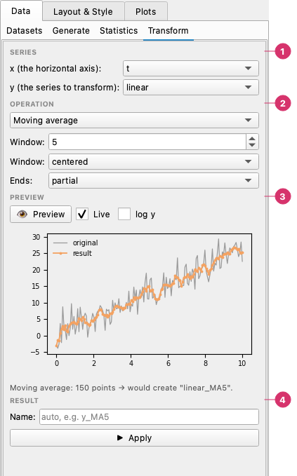
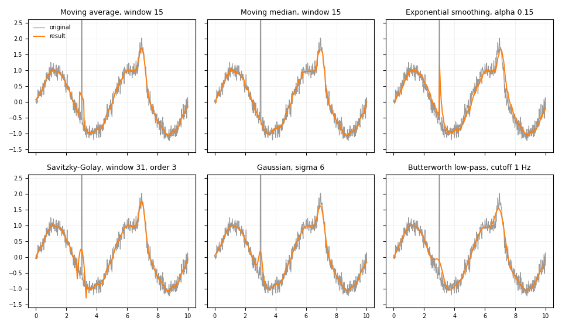
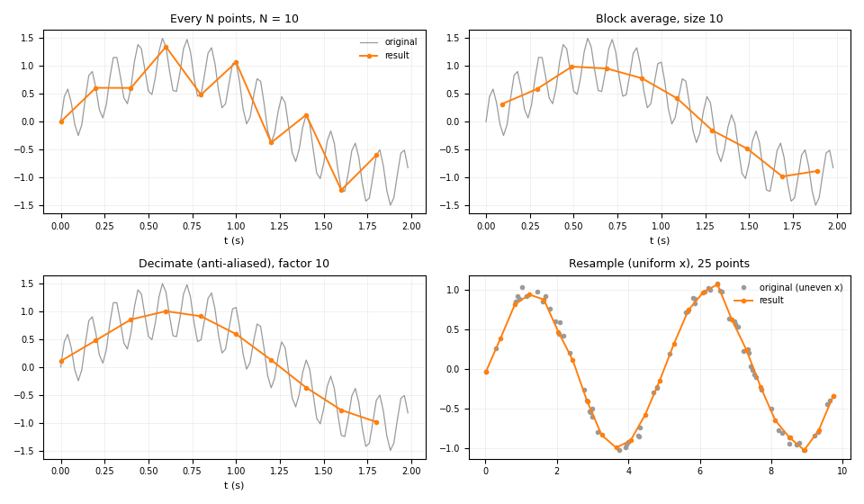
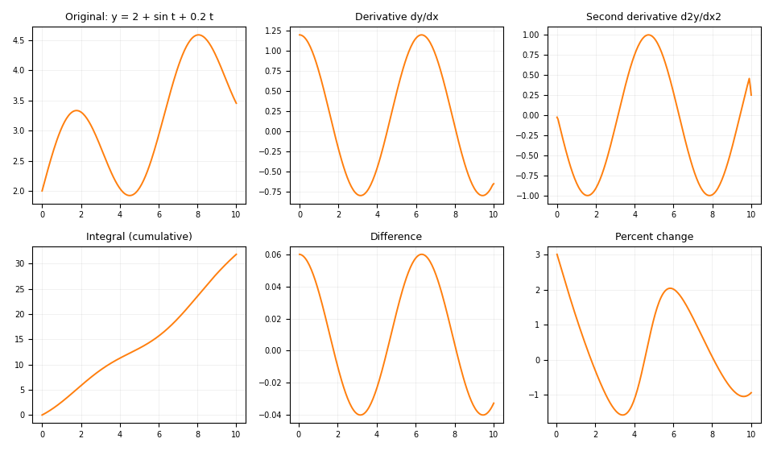
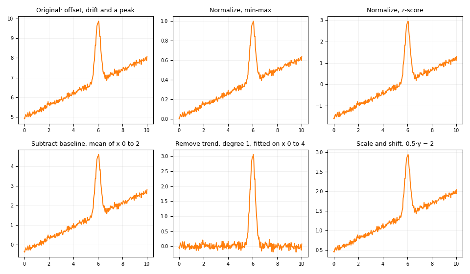
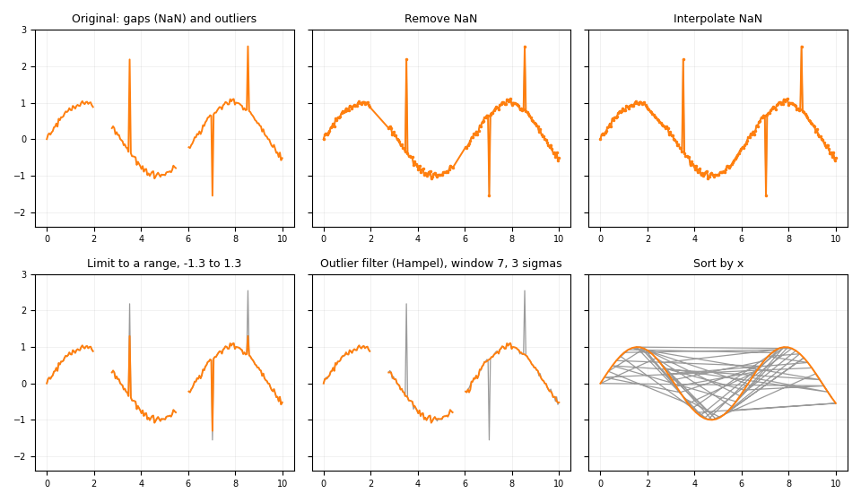
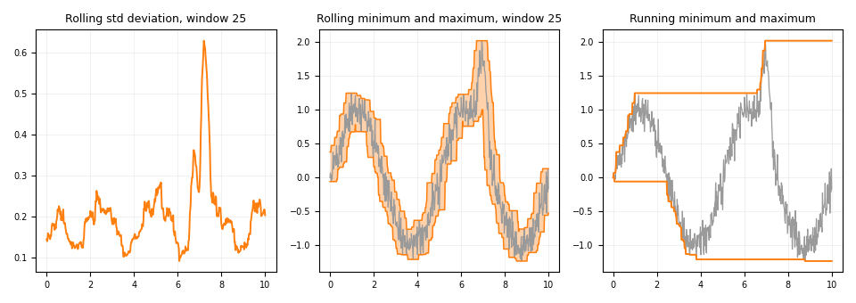
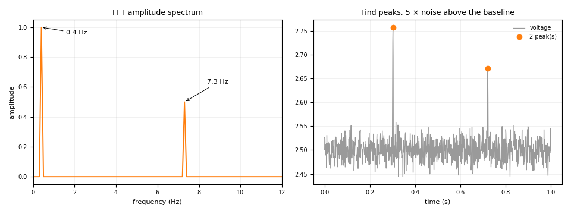

# Transform

The **Data → Transform** page creates new series from existing ones: smoothing, decimation, calculus, scaling, cleaning, resampling and signal analysis. To summarise series instead, see [Statistics](statistics.md).

---

The Transform page applies an operation (smoothing, decimation, calculus, scaling, cleaning, resampling…) to a series and stores the result as a **new series**. The original is never changed, so you can plot both together.

The **Transform** page:

1. **Series** — **x** is the horizontal axis (optional) and **y** the series to transform.
2. **Operation** — The operation, grouped by type, and its parameters, which change with the operation.
3. **Preview** — What **Apply** would create, without creating anything. See [Preview](#preview).
4. **Result** — The name of the new series (automatic when empty) and the **Apply** button.

## Using it

1. **x** — the horizontal axis (for example the time or position series). Optional: choose `(none: use index)` when the series has no x column. Operations that need an x (resampling, cropping, sorting, aligning) report an error without it. Derivatives and integrals use the index as the spacing when there is no x.
2. **y** — the series to transform (the values: the signal, the measurement). Swapping x and y gives odd results, because the result is calculated *as a function of x*: resampling `y_irregular` over `t_irregular` is a different curve from resampling `t_irregular` over `y_irregular`.
3. **Operation** — pick it from the list, which is grouped by type (the group names are bold headers).
4. Set the parameters, which change with the operation.
5. Optionally type a **Name** for the result; the default is the series name plus a suffix, for example `signal_MA5`.
6. Click **Apply**.

The status line under the button says what was created and how many points it has. New series appear at once in the Datasets list and in the series table.

## Preview

Below the parameters, a small plot shows what **Apply** would create, without
creating anything: the original series in grey and the result on top of it.
It uses the same calculation as Apply, so what you see is what you get.

- **Preview** draws it once. **Live** (on by default) redraws shortly after
  any change — series, operation or parameter.
- Peaks are drawn as markers. A spectrum is drawn alone, since its x axis is
  different. Date columns get a date axis. **log y** helps with spectra.
- Long series are drawn with a reduced number of points (the highs and lows
  are kept). Above 50,000 points Live pauses; use **Preview**.
- Problems (a window longer than the series, no x for a resample, ...) are
  written in the plot area instead of showing a dialog.
- Under the plot, a line says how many points go in and the name of the
  series that would be created.

## Dates

When x is a date column, the operations that keep or select x values keep it as dates: the new x series from cropping, decimating, resampling, aligning, removing NaN or finding peaks is a date series, and plots with a date axis. Notes:

- **Crop x range**: type the limits as dates, for example `2024-03-01` or `1 Mar 2024 12:00`. Leave a box empty for no limit.
- **Resample (uniform x)**, derivatives, integrals and filters work in **days**: the derivative is per day, and the Butterworth cutoff is in cycles per day.
- **FFT amplitude spectrum**: the frequencies are in cycles per day, and are not dates.
- Moving average, median and the other window operations count **points**, not time, so they assume regular sampling; use *Resample (uniform x)* first if the dates are irregular.

!!! note "Results are calculated once"
    A transformed series is a copy. If you later change or reload the original data, the transformed series is not recalculated — apply the operation again.

## When x changes

Some operations change the number or position of the points (decimating, cropping, resampling, removing NaN, FFT, peaks…). When that happens a **new x series** is created next to the new y, named after the x series and the suffix, for example `t_every3` and `y_every3`. Plot the pair together.

- **FFT** and **Find peaks** create their own x even if you chose none: frequencies for the FFT, and the x of each peak (the point index when there is no x series).
- **Align to another x** reuses the x of the series you chose instead of creating a duplicate; the status line tells you which series to use as x.

## Operations

### Smoothing

The same signal — a slow wave, a narrow bump at t = 7 s, a two-point spike and noise — smoothed six ways (grey: the original; orange: the result). The moving median ignores the spike, which the other filters turn into a bump. The moving average and Savitzky-Golay keep the height of the narrow bump best in this example; the Gaussian and the Butterworth filter round it off more.

| Operation | Parameters | Notes |
|-----------|-----------|-------|
| Moving average | Window, centered/trailing, ends | Ends: `partial` averages the points that exist, `nan` leaves NaN where the window is incomplete, `trim` removes those points (and their x) |
| Moving median | Window | Robust against isolated spikes; the window is rounded up to an odd number |
| Exponential smoothing | Alpha (0–1) | `s[i] = α·y[i] + (1−α)·s[i−1]`; a smaller alpha smooths more |
| Savitzky-Golay | Window, polynomial order | Local polynomial fit; keeps peak heights and widths better than a plain average. The order must be lower than the window |
| Gaussian | Sigma (in points) | Gaussian kernel |
| Low/high-pass filter (Butterworth) | Type, cutoff, order | Zero-phase. The cutoff is in cycles per x unit (cycles per point with no x) and must be below half the sampling rate. x should be evenly spaced and y must have no NaN |

### Reduce and resample

A 0.4 Hz wave plus a 7.3 Hz one, sampled at 50 Hz, reduced to a tenth of the points. **Every N points** just keeps one point in ten, so the fast component is folded into a false slow wave (aliasing). **Block average** averages each block and lowers the amplitude. **Decimate** filters first, so only the real slow wave is left. The last panel shows unevenly spaced samples put on a uniform x grid with **Resample**.

| Operation | Parameters | Notes |
|-----------|-----------|-------|
| Every N points | N, start at | Keeps one point out of every N |
| Block average | Block size | Replaces each block by its mean, x included; a short last block is kept |
| Resample (uniform x) | Points, step | Linear interpolation onto equally spaced x. Give a **step** (for example `0.001` for a sample every millisecond) to fix the spacing instead of the number of points; the step wins when both are set. Needs x |
| Decimate (anti-aliased) | Factor | Low-pass filters first, then keeps every N-th point. y must have no NaN |
| Align to another x | Series, interpolation | Interpolates y onto the x of another series (`linear` or `pchip`); NaN outside the range of the original x. Needs x |
| Crop x range | x min, x max | Keeps `x min ≤ x ≤ x max`; leave a bound on `auto` to leave it open. Needs x |

### Calculus

One smooth series (top left) and five operations on it. The **derivative** and the **second derivative** are its slope and curvature (the second derivative of 2 + sin t + 0.2t is −sin t). The **cumulative integral** is the area so far, starting at 0. **Difference** is the change from one point to the next, and **Percent change** the same relative to the previous value; the first point of both is NaN.

| Operation | Notes |
|-----------|-------|
| Derivative dy/dx | Central differences |
| Second derivative d2y/dx2 | Needs at least 3 points |
| Integral (cumulative) | Trapezoid rule; the running total starts at the value you give in **Starts at** (the constant of integration, 0 by default) |
| Difference | `y[i] − y[i−1]`; the first point is NaN |
| Percent change | `100·(y[i] − y[i−1]) / abs(y[i−1])`; the first point is NaN |
| Log return | `ln(y[i] / y[i−1])`; all values must be positive |
| Cumulative sum | Running total |

### Scale and baseline

A series with an offset, a drift and a peak. **Normalize** rescales it to 0–1 (*min-max*) or to mean 0 and standard deviation 1 (*z-score*). **Subtract baseline** with *mean of range* takes a quiet stretch (x from 0 to 2) as the zero, which removes the offset but not the drift. **Remove trend** fits a straight line only on x from 0 to 4, before the peak, so that the peak does not tilt it, and subtracts it from the whole series. **Scale and shift** applies a·y + b.

| Operation | Parameters | Notes |
|-----------|-----------|-------|
| Normalize | Method | `min-max` → 0 to 1; `z-score` → mean 0, std 1; `first` → divide by the first value; `max` → divide by the largest absolute value; `value` → divide by a number you type; `mean of range` → divide by the mean over an x range (for example the resting reading) |
| Scale and shift | a, b | `a·y + b` |
| Subtract baseline | Baseline | First value, last value, mean, median or minimum; a fixed **value**; or the **mean / median of a range** of x (a quiet stretch, so a peak does not pull the baseline up). The *Value* and *x from / x to* boxes appear only for the methods that use them; leave a limit empty to leave it open |
| Absolute value | — | |
| Remove trend (polynomial) | Degree, fit from x, fit to x | Subtracts a least-squares polynomial; degree 1 is a straight line. Limit the fit to a stretch of x (without the peak) so the peak does not tilt it; the result is subtracted over the whole series |

### Cleaning

A series with two gaps (NaN) and three outliers; grey is the original. **Remove NaN** drops the missing points, so the line jumps across each gap, while **Interpolate NaN** keeps every point and fills the gaps linearly. **Limit to a range** clips the outliers to the limits. The **Hampel filter** replaces them by the local median and leaves the other points as they were. The last panel shows points that arrive out of order, and **Sort by x** putting them right.

| Operation | Parameters | Notes |
|-----------|-----------|-------|
| Remove NaN | — | Drops points where y or x is NaN/inf, from both series |
| Interpolate NaN | — | Fills gaps linearly using x (or the index); the ends hold the nearest valid value |
| Limit to a range | Lower, upper | Clips y; leave a limit on `auto` to leave it open |
| Sort by x | — | Reorders the points so x increases. Needs x |
| Outlier filter (Hampel) | Window, sigmas | Replaces a point by the local median when it is more than *sigmas* robust standard deviations away from it |

### Rolling statistics

A noisy signal. The **rolling standard deviation** shows where it varies most. The **rolling minimum and maximum** draw an envelope that follows the signal. The **running** minimum and maximum never go back: they are the smallest and largest values so far.

| Operation | Parameters | Notes |
|-----------|-----------|-------|
| Rolling std deviation | Window | Centered; the ends use the points that exist |
| Rolling minimum / maximum | Window | Same |
| Running minimum / maximum | — | Cumulative: the smallest or largest value so far |

### Signal analysis

Left: the spectrum of the 0.4 Hz plus 7.3 Hz signal above, with one line at each frequency and the amplitudes 1 and 0.5. Right: **Find peaks** on the `pulse_signal.csv` sample, with the threshold set to 5 times the noise, finds the two pulses and nothing in the noise.

| Operation | Parameters | Notes |
|-----------|-----------|-------|
| FFT amplitude spectrum | Remove mean | Single-sided amplitude. x gives the sampling interval, so it should be evenly spaced; y must have no NaN. Output: frequency and amplitude |
| Find peaks | Min height (× noise), min height, min prominence, min distance | Local maxima. Output: only the peak points. **Min height (× noise)** sets the threshold at the median plus *k* times the noise of the series (estimated robustly, so a few peaks do not inflate it; remove any drift first). With *Min height* as well, the higher limit applies. Prominence is measured against the valleys around a peak, so with noise it needs about 8 times the noise level; a height threshold of about 5 times is simpler. An error is shown if there are no peaks |

!!! tip "Recipes"
    - **Remove spikes, then smooth:** *Outlier filter (Hampel)*, then *Savitzky-Golay* on the result.
    - **Find the dominant frequency:** *Remove trend*, then *FFT amplitude spectrum*, and plot the spectrum.
    - **Uneven sampling:** *Resample (uniform x)* before a Butterworth filter or an FFT.
    - **Pulse in a stable signal with noise:** *Subtract baseline* (**median of range**, over a stretch without the pulse), then *Savitzky-Golay* with a window no longer than the pulse (in points), then *Find peaks* with **Min height (× noise)** of 5 or 6 and a *Min distance* of the pulse width. Do not use the moving median or the outlier filter: they treat the pulse as noise and remove it. For a negative pulse, *Scale and shift* with a = −1 first.
    - **Compare two series with different x:** *Align to another x* puts one on the x of the other.
